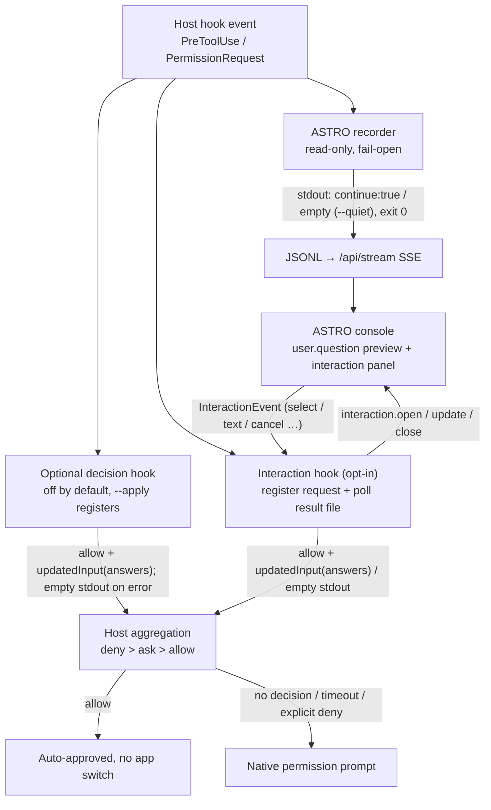

# AskUserQuestion Interaction Hook Flow Design

> **Status: implemented; real-host acceptance pending.** The interaction hook,
> the `/api/interactions` service, the SSE `interaction.open` / `update` / `close`
> frames, the console panel, `AgentNotification` and the installer all exist and
> are covered by the automated tests in §10. **Not yet done** is the real Claude /
> ZCode host acceptance (plan F3): this machine cannot launch a host session
> (Claude is config-only; ZCode / CodeBuddy are GUI desktop apps whose agent runs
> only inside the app process, so no headless CLI exists to drive one), so
> `/hooks` visibility and `Allowed by PermissionRequest hook` / `hook.run.failed`
> were not re-checked in a live session. `pnpm verify:host-integration` now
> machine-generates a host-availability probe and a runbook into
> `plans/host-acceptance-03.md` so the remaining F3 steps are a copy-paste on a
> host-equipped machine. For working configuration see `docs/plugin-installation.md`;
> this document stays the contract source for the channel, so change it before
> changing the implementation.

## 1. Diagram review

The original "Hook observation channel and decision channel" diagram has six
nodes: host hook event → left "ASTRO recorder (`continue:true` / empty
`--quiet` stdout, JSONL only, exit 0)" → "host still prompts"; right "decision
hook (`hookSpecificOutput: allow` + `updatedInput / answers`)" → "host
auto-approves". Checked against `ce513d8` and the follow-up documentation, the
diagram is **incomplete**.

| # | Missing | Current fact | Section |
| --- | --- | --- | --- |
| A | Two decision protocols collapsed into one `allow` | `PreToolUse` uses `permissionDecision:"allow"` + top-level `updatedInput` (`modifiedInput` on CodeBuddy); `PermissionRequest` uses `decision.behavior:"allow"` + `decision.updatedInput` | §2, §6.2 |
| B | No fail-open third branch | Unmatched events, missing fields or parse errors → empty stdout + exit 0, host falls back to its prompt | §2, §6.2, §7 |
| C | Decision hook drawn as always present | Off by default; `install-auto-approve-hook.mjs` is dry-run until `--apply`, backs up, is idempotent, and supports `--remove --apply`; ZCode needs `hooks.enabled:true`, `hooks.events`, and a new session | §2.1, §7 |
| D | No aggregation or non-bypassable rules | `deny > ask > allow`; explicit deny rules, plan-mode write bans and hard tool limits win; the recorder's `{continue:true}` is neutral | §2, §9 |
| E | Observation channel stops at JSONL | JSONL → `GET /api/stream` (`reset` / `trace` / `ready` / `resume`) → console `user.question` preview with `prompts` / `message` / `plan` / `answers` | §2, §6.3 |
| F | Root cause of the app switch not labelled | `POST /api/events` only writes TraceEvents; `/api/stream` is one-way; there is no reverse answer channel | §2.1, §6.3 |
| G | No host coverage differences | Three configs (Claude / ZCode / CodeBuddy); Codex, OpenCode, Pi and DeepSeek Harness have no command-hook decision channel | §2.1, §9 |
| H | No `answers` semantics | Keys are exact question text, values are option labels, multi-select is comma-joined; `ANSWER=all` and `ASTRO_AUTO_APPROVE_ANSWERS` override; injected by the host hook, not produced by the agent | §5.4, §6.2 |
| I | No human-interaction loop | Closed: interaction hook registers → SSE `interaction.open` → console panel answers → `InteractionResult` → `answers` returned → `Notification` informs the Agent; real-host acceptance still pending (plan F3) | §3–§8 (implemented) |

## 2. Complete channel model



### 2.1 Implemented vs unfinished

- **Implemented**: read-only recorder contract; two stdout decision shapes,
  fail-open, `answers`, custom answer maps, installer/removal and ZCode config
  validation; console parsing of `questions` / `message` / `plan` / `answers`.
- **Implemented (new in this document)**: interaction hook, four
  `/api/interactions` routes, three SSE interaction frames, console panel,
  `InteractionEvent` / `InteractionResult` / `AgentNotification` contracts, the
  `Notification` TraceEvent and `scripts/install-interaction-hook.mjs`.
- **Unfinished**: real Claude / ZCode host acceptance (plan F3, §10).
- The split between channels is unchanged: `POST /api/events` still only writes
  TraceEvents; answers travel solely through
  `POST /api/interactions/:id/close` and the result file.

## 3. Execution timing

### 3.1 Synchronous decision window (implemented)

Host fires `PreToolUse` / `PermissionRequest` → matching hooks run in parallel
(5 s in this repo, ZCode `timeoutMs: 5000`) → each reads stdin, writes stdout,
exits 0 → host aggregates `deny > ask > allow` → the tool runs and the recorder
captures `PostToolUse`. `Notification` has **no decision control**.

### 3.2 Human interaction (implemented)

```mermaid
sequenceDiagram
  participant Agent as Host Agent
  participant Hook as Interaction Hook
  participant Bridge as Local interaction service
  participant UI as Console / external device
  participant Store as TraceStore / SSE
  Agent->>Hook: stdin: InteractionRequest (PreToolUse or PermissionRequest)
  Hook->>Bridge: register pending request (requestId, TTL, questions)
  Note over Hook,Store: the recorder writes the PermissionRequest TraceEvent; the hook never duplicates it
  Bridge->>UI: SSE interaction.open
  UI->>Bridge: InteractionEvent (select / text / edit / cancel / submit)
  Bridge->>Hook: aggregate into InteractionResult (answers)
  Hook->>Agent: stdout: allow + updatedInput.answers
  Hook->>Agent: additionalContext / systemMessage (notification)
  Agent->>Hook: PostToolUse (tool_response with answers)
  Hook->>Store: write PostToolUse TraceEvent
  Store->>UI: SSE trace (preview shows Answers)
```

### 3.3 Timeout and fallback (critical)

Hooks are **synchronous and blocking**. Human response time usually exceeds the
5-second window, so a hook must never wait indefinitely. The implementation
takes the **fast path**:

1. **Fast path (implemented)**: derive `ttlMs = timeout - 500` from
   `ASTRO_INTERACTION_TIMEOUT_MS` (default 5000 ms) and poll the result file
   inside that window. `answered` → `allow + updatedInput.answers`; `cancelled`
   or a miss → **empty stdout + exit 0** so the native prompt appears. The real
   choice is recorded later through `PostToolUse`.
2. **Re-entry path (not implemented, kept as an alternative)**: return `deny`
   with `permissionDecisionReason`, letting the agent ask again next turn. Costs
   a model turn; cap retries at 1 per `requestId`.

Never let the hook time out, `exit 2`, or return `continue:false`; all three
break the fail-open boundary.

## 4. Interaction behavior matrix

| Behavior | Trigger | `action` | Payload | Result | Idempotency / constraint |
| --- | --- | --- | --- | --- | --- |
| Single-select click | Option card | `select` | `question`, `optionLabel` | Overwrites that answer | Highest `seq` wins per `requestId` + `question` |
| Multi-select / deselect | `multiSelect:true` | `select` / `deselect` | `optionLabel` | Labels joined in `options` order | Deduplicate; no repeated label |
| Free-text input | "Other" field | `text` | `text` | Becomes that answer | 1..2000 chars, trimmed, no executable markup |
| Edit an answer | Repeated click or typing | `edit` | `previous`, `next` | Replaces answer | Keep `revision` for audit |
| Submit | Confirm / Enter | `submit` | Full `answers` snapshot | Produces `InteractionResult` | All required questions must be covered |
| Cancel | Cancel / Esc | `cancel` | `reason?` | No `answers`; native prompt | Do not write `deny`; `final:true` ends the request |
| Skip | Optional question | `skip` | `question` | Omitted from `answers` | Only when `required:false` |
| Timeout | `expiresAt` reached | `timeout` | `elapsedMs` | Native prompt | Single timer, no replay |
| Duplicate submit | Double click / retry | repeated `submit` | Same `requestId` | Ignored | `requestId` + `final` |
| Device takeover | Phone/desktop answers first | `takeover` | `deviceId` | Other devices read-only | First `final` wins; broadcast `interaction.close` |
| Session invalidated | Session end / interrupt | `expire` | `sessionId` | Drop pending request | Never emit a late decision |
| Question replaced | Agent rewrote questions | `replace` | New `questions` | Rebuild request | Increment `revision`, invalidate old `requestId` |
| Non-question tool | `Bash` / `Write` | — | — | Empty stdout, exit 0 | Matcher stays `AskUserQuestion|ExitPlanMode` |
| Hook crash / bad output | Script error | — | — | Native prompt | Empty stdout + exit 0; stderr diagnostics only |

## 5. Data structures (implemented: `plugin/interaction-contract.mjs`)

These five shapes are **message contracts** with exactly one implementation:
`plugin/interaction-contract.mjs`. The installed runtime copies only `plugin/`,
`server/` and `dist/`, so the contract cannot live under `src/`;
`src/lib/interaction-contract.ts` is the typed facade. Field names follow the
snake_case convention of `TraceEvent.payload`.

### 5.1 QuestionDescriptor

```json
{
  "question": "Which framework?",
  "header": "Framework",
  "options": [
    { "label": "React", "description": "Component library" },
    { "label": "Vue", "description": "Progressive framework" }
  ],
  "multiSelect": false,
  "required": true
}
```

`question`: 1..500 chars, preserved verbatim as the `answers` key.
`header`: 0..40 chars, display only. `options`: 2..8 unique labels of 1..120
chars, optional `description`. `multiSelect`: default `false`, comma-joins
labels in `options` order. `required`: default `true`; only `false` allows `skip`.

### 5.2 InteractionRequest

```json
{
  "requestId": "irq-01J8Z...",
  "schemaVersion": 1,
  "hookEventName": "PermissionRequest",
  "toolName": "AskUserQuestion",
  "toolUseId": "call_001",
  "sessionId": "sess_73e39835",
  "source": "zcode",
  "cwd": "/workspace/demo",
  "createdAt": "2026-11-15T14:00:00.000Z",
  "expiresAt": "2026-11-15T14:00:04.500Z",
  "ttlMs": 4500,
  "revision": 1,
  "questions": ["...QuestionDescriptor..."]
}
```

`requestId` is an idempotency key (UUID/ULID). `hookEventName` ∈
{`PreToolUse`, `PermissionRequest`}; `toolName` ∈
{`AskUserQuestion`, `ExitPlanMode`}; `ttlMs ≤ hookTimeoutMs - 500`;
`expiresAt` is ISO 8601; `questions` has 1..4 entries. No tokens, credentials or
full source text.

### 5.3 InteractionEvent

```json
{
  "requestId": "irq-01J8Z...",
  "eventId": "iev-01J8Z...",
  "seq": 7,
  "action": "select",
  "deviceId": "console",
  "at": "2026-11-15T14:00:02.120Z",
  "question": "Which framework?",
  "optionLabel": "React",
  "text": null,
  "final": false
}
```

`action` ∈ `select` / `deselect` / `text` / `edit` / `submit` / `cancel` /
`skip` / `timeout` / `takeover` / `expire` / `replace`. `seq` strictly increases;
`final:true` only on `submit` / `cancel` / `timeout` / `expire`; `text` and
`optionLabel` are mutually exclusive; `replace` carries new `questions` and
`revision+1`; one event ≤ 8 KiB.

### 5.4 InteractionResult

```json
{
  "requestId": "irq-01J8Z...",
  "status": "answered",
  "answers": { "Which framework?": "React", "Pick tools": "A, B" },
  "answeredBy": "console",
  "answeredAt": "2026-11-15T14:00:03.000Z",
  "elapsedMs": 3000
}
```

`status` ∈ `answered` / `cancelled` / `timeout` / `expired`. On `answered`, each
key must exactly equal a `questions[].question`; each value must be a declared
label, comma-joined multi-select labels, or free text from a `text` action.
Unknown keys, empty values and plan content are dropped; serialized `answers`
≤ 4000 chars. Other statuses require `answers: {}`.

### 5.5 AgentNotification

See §8.2.

## 6. Message formats

### 6.1 Host → hook (stdin, implemented)

One line of JSON + newline. Claude / CodeBuddy use `tool_name`, `tool_input`,
`tool_use_id`; ZCode supplies both camelCase and snake_case aliases.

```json
{
  "hook_event_name": "PermissionRequest",
  "session_id": "sess_73e39835",
  "tool_name": "AskUserQuestion",
  "tool_use_id": "call_001",
  "tool_input": {
    "questions": [
      { "question": "Which framework?", "header": "Framework",
        "options": [{ "label": "React" }, { "label": "Vue" }], "multiSelect": false }
    ]
  }
}
```

### 6.2 Hook → host (stdout, implemented)

```json
// PreToolUse
{ "hookSpecificOutput": { "hookEventName": "PreToolUse",
  "permissionDecision": "allow", "permissionDecisionReason": "auto-approved",
  "updatedInput": { "questions": ["..."], "answers": { "Which framework?": "React" } } } }

// PermissionRequest
{ "hookSpecificOutput": { "hookEventName": "PermissionRequest",
  "decision": { "behavior": "allow",
    "updatedInput": { "questions": ["..."], "answers": { "Which framework?": "React" } } } } }
```

`updatedInput` is a **full replacement**: echo the original `questions` or host
schema validation fails. CodeBuddy `PreToolUse` uses `modifiedInput`
(`ASTRO_AUTO_APPROVE_INPUT_FIELD=modifiedInput`). `ExitPlanMode` echoes `plan` /
`planFilePath` / `allowedPrompts` and produces no `answers`. Fail-open: no stdout
and exit 0, diagnostics on stderr only. Never use `decision:"block"`,
`continue:false` or exit 2 to mean "no opinion". `additionalContext`,
`systemMessage` and `permissionDecisionReason` are capped at 10,000 characters
by the host.

### 6.3 Interaction channel messages (implemented)

`GET /api/stream` frames are `event: <name>\ndata: <JSON>\n\n`. Besides the
existing `reset` / `trace` / `ready` / `resume`, the interaction channel adds
three frames:

```
event: interaction.open
data: {"requestId":"irq-01J8Z...","questions":["..."],"expiresAt":"...","revision":1}

event: interaction.update
data: {"requestId":"irq-01J8Z...","eventId":"iev-...","seq":7,"action":"select","deviceId":"console"}

event: interaction.close
data: {"requestId":"irq-01J8Z...","status":"answered","answeredBy":"console"}
```

Write-side routes (in-memory record plus one atomic file for the synchronous
hook to poll):

| Route | Purpose | Idempotency / validation |
| --- | --- | --- |
| `POST /api/interactions` | Register a pending request; returns `requestId` / `expiresAt` / `ttlMs` | A repeated `requestId` returns 200 without resetting the timer |
| `POST /api/interactions/:id/events` | Append an `InteractionEvent` | `seq` strictly increasing; a repeated `eventId` returns the stored outcome |
| `POST /api/interactions/:id/close` | Close and produce an `InteractionResult` | First final wins; later closes return 200 without overwriting |
| `GET /api/interactions/:id` | A late tab or reconnect reads `{request, events, result}` | Unknown id → 404 |

Frames ≤ 8 KiB; `requestId` is idempotent; `interaction.close` fires exactly
once; `reset` / `reset-same` clears the console's pending panel (interactions
are live-only and never replayed). `POST /api/events` accepts only TraceEvent
structures (§6.4) and **must not** carry answers back to the host: answers
travel solely through `close` and the result file.

### 6.4 TraceEvent projection

The question row is written by the **recorder** for the same host hook event. The
interaction hook only registers the request: both run in parallel, and a second
`PermissionRequest` write put two identical question rows in the LOG.

Interaction produces only existing canonical events; no new event names:

| Stage | `eventName` | Key `payload` fields | Display key |
| --- | --- | --- | --- |
| Question raised | `PreToolUse` / `PermissionRequest` | `tool_input.questions`, `tool_input.plan` | `user.question` |
| Answer returned | `PostToolUse` | `tool_input.answers`, `tool_response.answers` | `user.answer` |
| Cancel / denial | `PermissionDenied` | `reason`, `retry` | `user.question` (failure) |
| Notification | `Notification` | `message`, `notification_type`, `notification_id`, `interaction_request_id`, `answered` | `user.question` |

The service writes the `Notification` when an interaction closes
(`buildInteractionNotification` in `server/interaction-store.mjs` plus
`recordInteractionNotification` in `server/server.mjs`). It carries counts, the
device and elapsed time, never an answer value; a credential-shaped `answeredBy`
is replaced by the §10 recursive redaction (`sk-[redacted]`) before the row is
written.

Required `TraceEvent` fields are listed in `docs/event-protocol-en.md` §2.1
(`schemaVersion: 2`, `source`, `sessionId`, `eventName`, `nativeEventName`,
`payload`, `locator`, ...). `answers` is injected by the host hook, redacted per
§10 of that document, and only parsed for display by
`src/lib/user-question-content.ts`; persisted events are never rewritten.

## 7. Triggers and timeout boundaries

| Time | Trigger | Message | Timeout / fallback |
| --- | --- | --- | --- |
| T0 | Host fires `PreToolUse` | Recorder writes `PreToolUse`; interaction hook creates `InteractionRequest` | none |
| T0+ | Permission needed | `PermissionRequest` + `interaction.open` | `ttlMs ≤ timeout-500` |
| T1 | UI rendered | optional `interaction.update` | never blocks the hook |
| T2 | Each click / keystroke commit | one `InteractionEvent` with increasing `seq` | ≤ 8 KiB per event |
| T3 | Submit | `interaction.close` + `InteractionResult` | all required questions covered |
| T4 | Hook returns | `allow + updatedInput.answers` or empty stdout | must return on time |
| T5 | Tool completes | `PostToolUse` + `tool_response.answers` | SSE `trace` refreshes the preview |
| T6 | Notify Agent | `additionalContext` / `systemMessage` | ≤ 10,000 chars |
| T7 | No response / cancel / crash | empty stdout + exit 0 | native prompt takes over |

ZCode extras: user-level `hooks.enabled:true`; project-level hooks ignored;
configuration snapshotted at session start (open a new session); failures in
`~/.zcode/cli/log/zcode-<date>.jsonl`.

## 8. Agent notification message design

> **Implementation status:** `additionalContext` / `systemMessage` /
> `permissionDecisionReason` are emitted by the interaction hook, and the `trace`
> channel is written by the service as a `Notification` on close; `sse` and
> `terminalSequence` are not wired. `PermissionRequest` stdout keeps only
> `decision.behavior` / `decision.updatedInput` (ZCode's strict schema rejects
> extra keys), so the model-context notification appears on `PreToolUse` only.

### 8.1 Four channels

| Channel | Audience | Use | Constraint |
| --- | --- | --- | --- |
| `hookSpecificOutput.additionalContext` | Agent (model context) | "User answered; answers are in `tool_input.answers`" | Read on the next model request, not shown as a chat message |
| `systemMessage` | Human (terminal / UI warning) | "Answered from an external device", "Timed out, fell back to prompt" | Not model context; discarded by `Notification` / `StopFailure` |
| `permissionDecisionReason` | Agent or human (event dependent) | Explain a `deny`; on `allow` only reaches the debug log | Must not impersonate an answer |
| `terminalSequence` | Terminal | Bell / title / desktop notification | Works on events that discard `systemMessage` |

`Notification` hooks have **no decision control** and must not try to change a
permission outcome.

### 8.2 AgentNotification structure

```json
{
  "schemaVersion": 1,
  "notificationId": "ntf-01J8Z...",
  "requestId": "irq-01J8Z...",
  "kind": "answer_applied",
  "target": "agent",
  "channel": "additionalContext",
  "sessionId": "sess_73e39835",
  "toolUseId": "call_001",
  "at": "2026-11-15T14:00:03.100Z",
  "summary": "User answered 2 questions via console; answers are in tool_input.answers.",
  "detail": { "answered": 2, "skipped": 0, "answeredBy": "console", "elapsedMs": 3000 },
  "ttlMs": 0
}
```

`kind` ∈ `answer_applied` / `answer_cancelled` / `interaction_timeout` /
`fallback_prompt` / `question_replaced` / `device_takeover`.
`target` ∈ `agent` / `user` / `both`; `channel` ∈ `additionalContext` /
`systemMessage` / `permissionDecisionReason` / `terminalSequence` / `sse` /
`trace`.

### 8.3 Field constraints

- `summary`: 1..500 chars, plain text, no Markdown injection, control
  characters or executable fragments; contains counts and origin only, never
  the full `answers`.
- `detail`: counts, device id and elapsed time only; no tokens, full paths,
  source code or full plan text.
- `notificationId` + `requestId` form the idempotency key; one `kind` per
  request; `ttlMs` defaults to 0 and is ≤ 1000 for `sse` / `trace`.
- Redact before writing to trace (`docs/event-protocol-en.md` §10).
- Notifications never replace decisions: no `continue:false`, no `exit 2`.
- Never wrap a hook-provided answer as `UserPromptSubmit` or a user message;
  doing so corrupts prompt-run hierarchy.

### 8.4 Prohibited behavior

1. Presenting `answers` as an agent-produced `tool_response`.
2. Returning decision fields from a `Notification` hook.
3. Putting full answers or secrets in `systemMessage`.
4. Using `POST /api/events` as a host answer channel.
5. Blocking a hook past its timeout while waiting for a human.

## 9. Security and constraint summary

| Dimension | Constraint |
| --- | --- |
| Matcher | `AskUserQuestion|ExitPlanMode` only; never `*` or empty; ZCode uses exact name lists |
| Aggregation | `deny > ask > allow`; explicit deny, plan-mode write bans and hard limits are not bypassable |
| Default | Decision hook not installed until `--apply`; the interaction hook is likewise off until `install-interaction-hook.mjs --apply`, registers `PermissionRequest` only, and `--events=PreToolUse,PermissionRequest` widens it |
| Failure | Empty stdout + exit 0; stderr diagnostics only; never partial JSON |
| Idempotency | `requestId` + `seq` + `final`; duplicate submits ignored; one `interaction.close` |
| Sizes | ≤ 8 KiB per event; `answers` ≤ 4000 chars; notification strings ≤ 10,000 chars |
| Time | `ttlMs ≤ hookTimeoutMs - 500`; ISO 8601 `expiresAt`; single timer, no replay |
| Data | Raw `TraceEvent` immutable; `answers` display-only; redact before write |
| Clients | Codex / OpenCode / Pi / DeepSeek Harness have no command-hook decision channel |

## 10. Verification

Every executed check is a command:

| Check | Command | Result |
| --- | --- | --- |
| Contracts and validation | `node --test tests/interaction-contract.test.ts` | 10/10 |
| Hook window (fail-open, both stdout shapes, notification output) | `node --test tests/interaction-hook.test.mjs` | 12/12 |
| Store: atomic writes, idempotency | `node --test tests/interaction-store.test.mjs` | 6/6 |
| HTTP routes and the three SSE frames | `node --test tests/interaction-service.test.mjs` | 6/6 |
| End-to-end negatives against the real service | `node --test tests/interaction-integration.test.mjs` | 6/6 |
| Console reducer / panel model / panel source contract / client | `node --test tests/interaction-reducer.test.ts tests/interaction-panel-model.test.ts tests/interaction-panel-contract.test.ts tests/interaction-client.test.ts` | 11 + 8 + 5 + 7 |
| Notification shape | `node --test tests/agent-notification.test.ts` | 5/5 |
| Installer | `node --test tests/install-interaction-hook.test.mjs` | 6/6 |
| Host availability probe | `node --test tests/verify-host-probe.test.mjs` | 6/6 |
| Full regression | `pnpm test` / `pnpm typecheck` / `pnpm build` / `pnpm build:docs` | see the plan's progress log |
| Host equivalence acceptance | `pnpm verify:host-integration -- --out plans/host-acceptance-03.md` | 6/6 checks + machine-generated probe and runbook in `plans/host-acceptance-03.md` |

The equivalence check drives the real hook processes with a captured ZCode
question payload and validates the three host stdout schemas plus installer
config shapes; it does **not** replace launching a host. On every run it also
machine-generates a **host-availability probe** (PATH → known install path →
config dir, classifying each client as `cli` / `app` / `config-only` /
`absent`) and a **runbook** into `plans/host-acceptance-03.md`. Still not
executed (plan F3): real Claude `/hooks` visibility, the transcript line
`Allowed by PermissionRequest hook`, and a ZCode session with no
`hook.run.failed`. The probe records why this machine cannot run them (Claude
config-only; ZCode / CodeBuddy are GUI apps with no headless CLI), so the
item stays unchecked and the plan is not archived.

## 11. Implementation task breakdown

The executable backlog lives in
`plans/planing/03-ask-user-question-implementation-breakdown.md` (32 tasks,
A1–F5; 31 done). This section gives only the stage overview and dependency
order; each task's file paths, acceptance check and prerequisite are defined in
that plan.

| Stage | Tasks | Deliverable | Depends on | Stage acceptance |
| --- | --- | --- | --- | --- |
| A Contracts and validation | 5 | `src/lib/interaction-contract.ts` + tests | none | Five message types and four validators pass positive and negative cases |
| B Hook decision window | 6 | `scripts/interaction-hook.mjs` + tests | A | Both stdout shapes, ExitPlanMode echo and four fail-open cases pass |
| C Interaction service and SSE | 6 | `server/interaction-store.mjs`, four `/api/interactions` routes, three SSE frames | A | Atomic writes, seq / final idempotency and single-timer timeout pass |
| D Console interaction | 6 | `interaction-reducer.ts`, `interaction-panel.tsx` | C | Single / multi-select, text, cancel, closed state and Answers linkage pass |
| E Notification and observation | 4 | `agent-notification.ts`, notification output, redaction | B, C | Summary limits, notification writes and Prompt hierarchy pass |
| F Install and acceptance | 5 | Standalone installer, host integration record, doc status update | all | Negative tests pass, planned labels removed, docs consistent |

Dependency order: `A → B`, `A → C`; `B` and `C` can run in parallel; `D → C`;
`E → B` and `E → C`; `F → all`. Within a stage, follow the numeric order. Each
task touches at most 1–2 source files plus one test file and its acceptance
check is one runnable assertion or one spawn command; vague "finish module"
wording is not allowed.

Status: 31 of 32 tasks are done (A–E, F1, F2, F4, F5). F3 — real-host acceptance —
is blocked because this machine has no `claude` / `zcode` / `codebuddy` binary,
so the plan stays in `plans/planing/` and is not archived. Do not write "host
acceptance passed" into any document until F3 is done.

## 12. References

- `docs/plugin-installation.md` — current optional auto-approve hook setup.
- `docs/event-protocol-en.md` §2 / §4 / §9 / §10 — TraceEvent schema,
  projection, payload enrichment and redaction.
- `docs/architecture-en.md` §6 — TraceStore and SSE snapshot semantics.
- `AGENTS.md` — invariants for user-question classification, preview parsing and
  the decision-hook channel.
- `plans/planing/03-ask-user-question-implementation-breakdown.md` — 32
  implementation tasks with per-task paths and acceptance checks.
