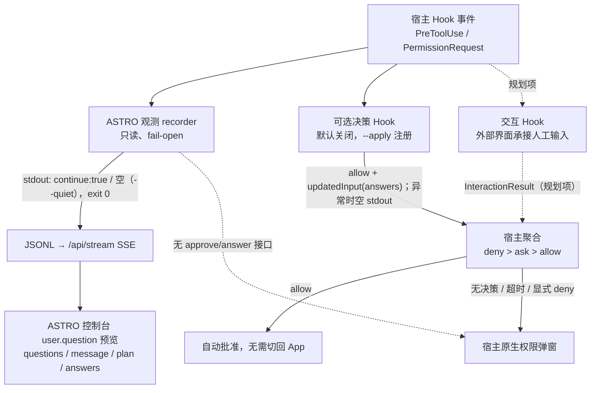
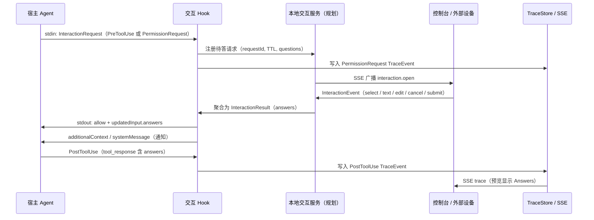

# AskUserQuestion 交互 Hook 执行流程设计

> **状态：规划项 / 未实现。** 本文描述「由 ASTRO 控制台或外部设备承接
> `AskUserQuestion` 人工交互」时应当遵守的通道模型、时序、数据结构、消息格式与
> 字段约束。当前仓库**只实现了自动同意**（`scripts/auto-approve-question-hook.mjs`），
> 采集链路仍是纯观测；服务端没有 approve / answer / reply 接口。本文不作为现有
> 能力的承诺，配置与验证以 `docs/plugin-installation.md` 为准。

## 1. 图核对结论

原图「Hook_观测通道与决策通道」有 6 个节点：宿主 Hook 事件 → 左「ASTRO 观测 hook
（`continue:true` / `--quiet` 空 stdout、只写 JSONL、退出码 0）」→「宿主照常弹确认」；
右「决策 hook（`hookSpecificOutput: allow` + `updatedInput / answers`）」→「宿主自动批准」。
逐项核对 `ce513d8` 及本轮文档补全后，结论是**不完整**，缺失如下。

| 编号 | 缺失内容 | 当前事实 | 本文落点 |
| --- | --- | --- | --- |
| A | 两套决策输出协议被合并成一个 `allow` | `PreToolUse` 用 `permissionDecision:"allow"` + 顶层 `updatedInput`（CodeBuddy 为 `modifiedInput`）；`PermissionRequest` 用 `decision.behavior:"allow"` + `decision.updatedInput` | §2、§6.2 |
| B | 没有 fail-open 第三分支 | 不匹配事件 / 缺字段 / 解析异常 → 空 stdout + exit 0，宿主回退正常弹窗 | §2、§6.2、§7 |
| C | 决策 hook 被画成常态存在 | 默认不安装；`install-auto-approve-hook.mjs` 默认 dry-run，`--apply` 才写并备份、幂等、`--remove --apply` 卸载；ZCode 需 `hooks.enabled:true` + `hooks.events` + 新会话 | §2.1、§7 |
| D | 缺多 hook 聚合与不可绕过规则 | 聚合 `deny > ask > allow`；显式 deny、计划模式写禁、硬工具限制优先；recorder 的 `{continue:true}` 是中立输出，不参与决策 | §2、§9 |
| E | 观测通道止于「只写 JSONL」 | JSONL → `GET /api/stream`（`reset` / `trace` / `ready` / `resume`）→ 控制台 `user.question` 预览，已支持 `prompts` / `message` / `plan` / `answers` 四种形状 | §2、§6.3 |
| F | 未标注「必须切回 App」的根因 | `/api/events` 只写入 TraceEvent，`/api/stream` 只单向推送，服务端没有反向应答通道 | §2.1、§6.3 |
| G | 缺宿主覆盖差异 | Claude / ZCode / CodeBuddy 三套配置；Codex、OpenCode、Pi、DeepSeek Harness 无命令 Hook 决策通道 | §2.1、§9 |
| H | 缺 `answers` 语义 | 键为问题原文、值为选项 label，多选逗号连接；`ANSWER=all` 与 `ASTRO_AUTO_APPROVE_ANSWERS` 可覆盖；由宿主 Hook 注入，不是 Agent 事实 | §5.4、§6.2 |
| I | 完全没有人工交互闭环 | 原图只有「自动批准」，没有选项点击 / 文本输入 / 取消 / 超时 → 回传 → 通知 Agent 的通路 | §3–§8（全部为规划项） |

## 2. 完整通道模型



### 2.1 已实现与规划项的边界

- **已实现**：观测 recorder 的只读契约；可选决策 Hook 的两种 stdout 决策、fail-open、
  `answers` 代答、自定义映射、安装/卸载与 ZCode 配置校验；控制台对
  `questions` / `message` / `plan` / `answers` 的解析与预览。
- **规划项（本文设计）**：交互 Hook、外部界面、双向应答服务、SSE 交互事件、
  `InteractionEvent` / `InteractionResult` / `AgentNotification` 消息、新的 `/api/*` 路由。
  这些在当前仓库**都不存在**，不得写成已实现。
- 服务端目前只有 `GET /api/stream`（单向推送）与 `POST /api/events`（写入
  TraceEvent）；两者都不具备把答复送回宿主的能力。

## 3. 执行时序

### 3.1 同步决策窗口（已实现）

宿主触发 `PreToolUse` / `PermissionRequest` → 所有匹配 Hook 并行执行（仓库配置 5 秒，
ZCode `timeoutMs: 5000`）→ Hook 读 stdin、写 stdout、exit 0 → 宿主按
`deny > ask > allow` 聚合 → 允许则工具继续执行，`PostToolUse` 再由 recorder 落盘。
`Notification` 事件**没有决策控制**，只能做转发或提示。

### 3.2 人工交互时序（规划项）



### 3.3 超时与回退（关键约束）

Hook 是**同步阻塞**的：人工等待时间通常远大于 5 秒，因此设计上不允许让 Hook 长时间
等待界面输入。可行策略只有两种，且必须二选一：

1. **快速路径（推荐）**：Hook 在 `min(ttlMs, timeout - 500ms)` 内轮询一次结果；
   命中则 `allow + updatedInput.answers`，未命中则**空 stdout + exit 0** 回退到宿主
   原生弹窗。随后通过 `PostToolUse` 把用户的真实选择记录进 trace。
2. **拒绝重入路径**：Hook 返回 `deny` 并附 `permissionDecisionReason`，让 Agent 在下一轮
   重新发起提问；代价是多一轮模型请求，且需防止无限循环（同一 `requestId` 最多 1 次）。

任何情况下不得让 Hook 超时、不得 `exit 2`、不得返回 `continue:false`：这些都会破坏
「采集失败放行」边界。

## 4. 交互行为矩阵

| 行为 | 触发时机 | `action` | 载荷要点 | 结果 | 幂等与约束 |
| --- | --- | --- | --- | --- | --- |
| 单选点击 | 选项卡片点击 | `select` | `question`, `optionLabel` | 覆盖该题答案 | 同 `requestId` + `question` 以 `seq` 最大者为准 |
| 多选点击 / 反选 | `multiSelect:true` | `select` / `deselect` | `optionLabel` | 结果按 `options` 原顺序逗号连接 | 去重；不得出现重复 label |
| 自由文本输入 | 「Other」输入框 | `text` | `text` | 作为该题答案 | 长度 1..2000，去除首尾空白，禁用可执行标记 |
| 编辑已选答案 | 再次点击或输入 | `edit` | `previous`, `next` | 替换答案 | 保留 `revision`，用于审计 |
| 提交 | 点击确认 / 回车 | `submit` | `answers` 全量快照 | 生成 `InteractionResult` | 必须覆盖全部必答问题；缺项不得提交 |
| 取消 | 点击取消 / Esc | `cancel` | `reason?` | 不生成 `answers`，回退原生弹窗 | 不写 `deny`；`final:true` 终止请求 |
| 跳过 | 非必答题跳过 | `skip` | `question` | 该题不进入 `answers` | 仅当 `required:false` |
| 超时 | `expiresAt` 到达 | `timeout` | `elapsedMs` | 回退原生弹窗 | 服务端单定时器，禁止重复触发 |
| 重复提交 | 双击 / 重发 | `submit` 重发 | 同 `requestId` | 忽略后续 | `requestId` + `final` 幂等 |
| 外部设备接管 | 手机 / 桌面端先响应 | `takeover` | `deviceId` | 其他端置为只读 | 首个 `final` 生效，广播 `interaction.close` |
| 会话失效 | 会话结束 / 中断 | `expire` | `sessionId` | 丢弃待答请求 | 不得再向宿主输出决策 |
| 方案变更 | Agent 改写了问题 | `replace` | 新 `questions` | 旧请求作废，重建 | `revision` 递增，旧 `requestId` 失效 |
| 非提问工具 | `Bash` / `Write` 等 | — | — | Hook 空 stdout、exit 0 | matcher 只含 `AskUserQuestion|ExitPlanMode` |
| Hook 崩溃 / 非法输出 | 脚本异常 | — | — | 回退原生弹窗 | 空 stdout + exit 0，stderr 仅诊断 |

## 5. 数据结构（规划项）

以下 5 个结构是**消息契约**，不是仓库现有 TypeScript 类型；字段名与
`TraceEvent.payload` 的 snake_case 习惯保持一致。

### 5.1 QuestionDescriptor

```json
{
  "question": "Which framework?",
  "header": "Framework",
  "options": [
    { "label": "React", "description": "Component library" },
    { "label": "Vue", "description": "Progressive framework" }
  ],
  "multiSelect": false,
  "required": true
}
```

| 字段 | 类型 | 约束 |
| --- | --- | --- |
| `question` | string | 1..500 字符；必须逐字保留，作为 `answers` 的键 |
| `header` | string | 0..40 字符；仅展示，不参与键匹配 |
| `options` | array | 2..8 项，每项 `label` 唯一且 1..120 字符；`description` 可空 |
| `multiSelect` | boolean | 默认 `false`；为真时答案按 `options` 顺序逗号连接 |
| `required` | boolean | 默认 `true`；为假才允许 `skip` |

### 5.2 InteractionRequest

```json
{
  "requestId": "irq-01J8Z...",
  "schemaVersion": 1,
  "hookEventName": "PermissionRequest",
  "toolName": "AskUserQuestion",
  "toolUseId": "call_001",
  "sessionId": "sess_73e39835",
  "source": "zcode",
  "cwd": "/workspace/demo",
  "createdAt": "2026-11-15T14:00:00.000Z",
  "expiresAt": "2026-11-15T14:00:04.500Z",
  "ttlMs": 4500,
  "revision": 1,
  "questions": ["...QuestionDescriptor..."]
}
```

约束：`requestId` 为幂等键（UUID/ULID）；`schemaVersion` 当前设计值 `1`；
`hookEventName` 仅 `PreToolUse` / `PermissionRequest`；`toolName` 仅
`AskUserQuestion` / `ExitPlanMode`；`ttlMs ≤ hookTimeoutMs - 500`；
`expiresAt` 为 ISO 8601；`questions` 1..4 项（与宿主工具 schema 一致）；
不得携带 token / 凭据 / 源码全文。

### 5.3 InteractionEvent

```json
{
  "requestId": "irq-01J8Z...",
  "eventId": "iev-01J8Z...",
  "seq": 7,
  "action": "select",
  "deviceId": "console",
  "at": "2026-11-15T14:00:02.120Z",
  "question": "Which framework?",
  "optionLabel": "React",
  "text": null,
  "final": false
}
```

`action` 枚举：`select` / `deselect` / `text` / `edit` / `submit` / `cancel` /
`skip` / `timeout` / `takeover` / `expire` / `replace`。
约束：`seq` 严格递增；`final:true` 仅允许 `submit` / `cancel` / `timeout` / `expire`；
`text` 与 `optionLabel` 互斥；`replace` 必须携带新 `questions` 与 `revision+1`；
单事件 ≤ 8 KiB。

### 5.4 InteractionResult

```json
{
  "requestId": "irq-01J8Z...",
  "status": "answered",
  "answers": { "Which framework?": "React", "Pick tools": "A, B" },
  "answeredBy": "console",
  "answeredAt": "2026-11-15T14:00:03.000Z",
  "elapsedMs": 3000
}
```

`status` 枚举：`answered` / `cancelled` / `timeout` / `expired`。
约束：`answered` 时 `answers` 的键必须逐字等于 `questions[].question`；值必须是
已声明的 `label`、逗号连接的多选 label，或 `text` 动作产生的自由文本；
未知键、空值、包含 `plan` 内容一律丢弃；`answers` 序列化后 ≤ 4000 字符。
`cancelled` / `timeout` / `expired` 时 `answers` 必须为 `{}`。

### 5.5 AgentNotification

见 §8.2。

## 6. 消息格式

### 6.1 宿主 → Hook（stdin，已实现）

一行 JSON + 换行。Claude / CodeBuddy 用 `tool_name` / `tool_input` / `tool_use_id`，
ZCode 同时提供 camelCase 与 snake_case 别名。

```json
{
  "hook_event_name": "PermissionRequest",
  "session_id": "sess_73e39835",
  "tool_name": "AskUserQuestion",
  "tool_use_id": "call_001",
  "tool_input": {
    "questions": [
      { "question": "Which framework?", "header": "Framework",
        "options": [{ "label": "React" }, { "label": "Vue" }], "multiSelect": false }
    ]
  }
}
```

### 6.2 Hook → 宿主（stdout，已实现）

```json
// PreToolUse
{ "hookSpecificOutput": { "hookEventName": "PreToolUse",
  "permissionDecision": "allow", "permissionDecisionReason": "auto-approved",
  "updatedInput": { "questions": ["..."], "answers": { "Which framework?": "React" } } } }

// PermissionRequest
{ "hookSpecificOutput": { "hookEventName": "PermissionRequest",
  "decision": { "behavior": "allow",
    "updatedInput": { "questions": ["..."], "answers": { "Which framework?": "React" } } } } }
```

- `updatedInput` 是**整体替换**，必须回显原 `questions`，否则宿主工具 schema 校验失败。
- CodeBuddy 的 `PreToolUse` 用 `modifiedInput`（`ASTRO_AUTO_APPROVE_INPUT_FIELD=modifiedInput`）。
- `ExitPlanMode` 回显 `plan` / `planFilePath` / `allowedPrompts`，不生成 `answers`。
- fail-open：不匹配 / 异常 → **不写 stdout**、exit 0；诊断只写 stderr。
- 禁止 `decision:"block"`、`continue:false`、exit 2 作为「无意见」表达。
- `additionalContext` / `systemMessage` / `permissionDecisionReason` 字符串上限
  10,000 字符（宿主侧限制）。

### 6.3 交互通道消息（规划项）

当前 `GET /api/stream` 的 SSE 帧为 `event: <name>\ndata: <JSON>\n\n`，
事件名只有 `reset` / `trace` / `ready` / `resume`；**没有**交互事件。设计新增：

```
event: interaction.open
data: {"requestId":"irq-01J8Z...","questions":["..."],"expiresAt":"...","revision":1}

event: interaction.update
data: {"requestId":"irq-01J8Z...","eventId":"iev-...","seq":7,"action":"select"}

event: interaction.close
data: {"requestId":"irq-01J8Z...","status":"answered","answeredBy":"console"}
```

约束：帧体 ≤ 8 KiB；`requestId` 必须幂等；`interaction.close` 必须且只能发一次；
连接断开后靠 `reset` 快照重建，不补播历史交互事件。
`POST /api/events` 只接受 TraceEvent 结构（见 §6.4），**不得**用它在宿主与界面之间
传答案：写入是单向落盘，不产生宿主应答。

### 6.4 TraceEvent 投影

交互过程只产生既有规范事件，不新增事件名：

| 阶段 | `eventName` | `payload` 关键字段 | 控制台显示键 |
| --- | --- | --- | --- |
| 提问发起 | `PreToolUse` / `PermissionRequest` | `tool_input.questions`、`tool_input.plan` | `user.question` |
| 答案回传 | `PostToolUse` | `tool_input.answers`、`tool_response.answers` | `user.answer` |
| 取消 / 拒绝 | `PermissionDenied` | `reason`、`retry` | `user.question`（失败态） |
| 通知 | `Notification` | `message`、`notification_type` | `user.question` |

`TraceEvent` 必填字段见 `docs/event-protocol-zh.md` §2.1（`schemaVersion: 2`、
`source`、`sessionId`、`eventName`、`nativeEventName`、`payload`、`locator` 等）。
`answers` 由宿主 Hook 注入，写入前经 `docs/event-protocol-zh.md` §10 的递归脱敏；
`src/lib/user-question-content.ts` 只做展示解析，不改写持久化事件。

## 7. 触发时机与超时边界

| 时刻 | 触发条件 | 产生消息 | 超时 / 回退 |
| --- | --- | --- | --- |
| T0 | 宿主触发 `PreToolUse` | recorder 写 `PreToolUse`；交互 Hook 建 `InteractionRequest` | 无 |
| T0+ | 需要权限确认 | `PermissionRequest` + `interaction.open` | `ttlMs ≤ timeout-500` |
| T1 | 界面渲染完成 | `interaction.update`（可选：已聚焦） | 不阻塞 Hook |
| T2 | 每次点击 / 输入 | 一条 `InteractionEvent`（`seq` 递增） | 单事件 ≤ 8 KiB |
| T3 | 提交 | `interaction.close` + `InteractionResult` | 必须覆盖全部必答题 |
| T4 | Hook 返回 | `allow + updatedInput.answers` 或空 stdout | 到点必须返回，不得挂起 |
| T5 | 工具完成 | `PostToolUse` + `tool_response.answers` | SSE `trace` 更新预览 |
| T6 | 通知 Agent | `additionalContext` / `systemMessage` | ≤ 10,000 字符 |
| T7 | 无响应 / 取消 / 崩溃 | 空 stdout + exit 0 | 宿主原生弹窗接管 |

ZCode 额外约束：用户级 `hooks.enabled:true`、项目级配置被忽略、配置在会话启动时
快照（改配置后必须新开会话）、失败查 `~/.zcode/cli/log/zcode-<date>.jsonl`。

## 8. 向 Agent 发送通知的消息设计规范

### 8.1 四条通道与适用语义

| 通道 | 受众 | 用途 | 约束 |
| --- | --- | --- | --- |
| `hookSpecificOutput.additionalContext` | Agent（模型上下文） | 告知「用户已作答 / 答案摘要 / 下一步前提」 | 下一条模型请求才被读取，不作为聊天消息展示；`PreToolUse` / `PostToolUse` / `Stop` 等支持 |
| `systemMessage` | 人（终端/界面警告） | 提示「已由外部设备代答」「交互超时，已回退原生弹窗」 | 不进入模型上下文；`Notification` / `StopFailure` 会丢弃该字段 |
| `permissionDecisionReason` | Agent 或人（依事件而定） | `deny` 时解释原因；`allow` 时只进 debug 日志 | 不得用来伪装答案 |
| `terminalSequence` | 终端 | 响铃 / 标题 / 桌面通知 | `Notification` 等丢弃 `systemMessage` 的事件仍可用 |

`Notification` Hook **没有决策控制**，只能做转发；不得在其中尝试改写权限结果。

### 8.2 AgentNotification 结构

```json
{
  "schemaVersion": 1,
  "notificationId": "ntf-01J8Z...",
  "requestId": "irq-01J8Z...",
  "kind": "answer_applied",
  "target": "agent",
  "channel": "additionalContext",
  "sessionId": "sess_73e39835",
  "toolUseId": "call_001",
  "at": "2026-11-15T14:00:03.100Z",
  "summary": "User answered 2 questions via console; answers are in tool_input.answers.",
  "detail": { "answered": 2, "skipped": 0, "answeredBy": "console", "elapsedMs": 3000 },
  "ttlMs": 0
}
```

`kind` 枚举：`answer_applied` / `answer_cancelled` / `interaction_timeout` /
`fallback_prompt` / `question_replaced` / `device_takeover`。
`target` 枚举：`agent` / `user` / `both`；`channel` 枚举：
`additionalContext` / `systemMessage` / `permissionDecisionReason` / `terminalSequence` /
`sse` / `trace`。

### 8.3 字段约束

- `summary` 1..500 字符，纯文本，禁止 Markdown 注入、控制字符与可执行片段；
  不得包含完整 `answers`（答案只放 `tool_input.answers`），只写数量与来源。
- `detail` 只允许计数、设备标识、耗时；禁止 token、路径全文、源码、计划全文。
- `notificationId` 与 `requestId` 组成幂等键；同一 `kind` 对同一请求只发一次。
- `ttlMs` 默认 0（立即消费）；`sse` / `trace` 通道不得超过 1000。
- 写入 trace 前按 `docs/event-protocol-zh.md` §10 脱敏。
- 通知不得替代决策：不得用 `continue:false` 停止会话，不得用 `exit 2` 表达「已作答」。
- 不得把 Hook 代答包装成 `UserPromptSubmit` 或用户消息，避免污染 Prompt 子运行层级。

### 8.4 禁止行为

1. 把 `answers` 写成 Agent 产生的 `tool_response`（来源标注必须保留）。
2. 在 `Notification` Hook 中返回决策字段。
3. 用 `systemMessage` 传完整答案或密钥。
4. 用 `POST /api/events` 充当宿主应答通道。
5. 让 Hook 阻塞超过宿主 timeout 等待人工输入。

## 9. 安全与字段约束总表

| 维度 | 约束 |
| --- | --- |
| matcher | 仅 `AskUserQuestion|ExitPlanMode`，禁止 `*` 或空；ZCode 用精确名列表 |
| 聚合 | `deny > ask > allow`；显式 deny、计划模式写禁、硬工具限制不可被 `allow` 绕过 |
| 默认状态 | 决策 Hook 默认不安装，`--apply` 才注册；交互 Hook 属规划项，不得默认启用 |
| 失败语义 | 空 stdout + exit 0；stderr 仅诊断；不写部分 JSON |
| 幂等 | `requestId` + `seq` + `final`；重复提交忽略；`interaction.close` 只发一次 |
| 长度 | 单事件 ≤ 8 KiB；`answers` ≤ 4000 字符；通知字符串 ≤ 10,000 字符 |
| 时间 | `ttlMs ≤ hookTimeoutMs - 500`；`expiresAt` ISO 8601；单定时器，不补播 |
| 数据 | 原始 `TraceEvent` 不可变；`answers` 只做展示解析；递归脱敏后才落盘 |
| 客户端 | Codex / OpenCode / Pi / DeepSeek Harness 无命令 Hook 决策通道，走宿主原生权限模式 |

## 10. 验证方式（设计阶段）

1. 文档自洽：§1 的 A–I 每项在 §2–§9 有对应落点；所有规划项显式标注。
2. 载荷对齐：用真实 ZCode `PermissionRequest(AskUserQuestion)` 轨迹校验 §6.1 的
   stdin 字段、§5.4 的 `answers` 键与 `parseUserQuestionContent()` 输出一致。
3. 决策负例：非提问工具、非法 JSON、缺 `questions` 均产生空 stdout + exit 0。
4. 通知负例：`summary` 截断、幂等键重复、`Notification` 事件不返回决策。
5. 宿主集成（实现后）：Claude `/hooks` 可见、transcript 出现
   `Allowed by PermissionRequest hook`；ZCode 新会话且日志无 `hook.run.failed`。

## 11. 实施任务拆解

完整的可执行任务清单见
`plans/planing/03-ask-user-question-implementation-breakdown.md`（32 条，编号
A1–F5，待执行状态）。本节只给出阶段总览与依赖，每条任务的落点、验收点与前置
依赖以该计划文件为准。

| 阶段 | 任务数 | 交付物 | 依赖 | 阶段验收 |
| --- | --- | --- | --- | --- |
| A 契约与校验 | 5 | `src/lib/interaction-contract.ts` 与单测 | 无 | 5 类消息类型、4 个校验函数的正负例全绿 |
| B Hook 同步决策 | 6 | `scripts/interaction-hook.mjs` 与单测 | A | 两种 stdout 形状、ExitPlanMode 回显、4 类 fail-open 全绿 |
| C 交互服务与 SSE | 6 | `server/interaction-store.mjs`、4 个 `/api/interactions` 路由、SSE 三帧 | A | 原子写、seq / final 幂等、单定时器超时全绿 |
| D 控制台交互 | 6 | `interaction-reducer.ts`、`interaction-panel.tsx` | C | 单选 / 多选 / 文本 / 取消 / 关闭态与 Answers 联动全绿 |
| E 通知与观测 | 4 | `agent-notification.ts`、通知输出与脱敏 | B、C | summary 约束、通知写入、Prompt 层级无回归 |
| F 安装与验收 | 5 | 独立安装器、宿主集成记录、文档状态更新 | 全部 | 负例自动化通过、规划标注移除、文档一致 |

依赖顺序：`A → B`、`A → C`；`B` 与 `C` 可并行；`D → C`；`E → B` 与 `E → C`；
`F → 全部`。同阶段内按编号顺序执行。每条任务的判定口径是：只触及 1–2 个源文件
加 1 个测试文件，验收点是一条可运行断言或一个 spawn 命令；不含「完成某模块」这类
无法判定的描述。

实施开始前请注意：本文仍是**规划项 / 未实现**。只有 F5 完成后才可以把状态标注
改为「已实现」，且不得先于 32 条任务全部勾选。

## 12. 参考

- `docs/plugin-installation.md`：可选自动同意决策 Hook 的现有配置与验证。
- `docs/event-protocol-zh.md` §2 / §4 / §9 / §10：TraceEvent schema、投影、补齐与脱敏。
- `docs/architecture-zh.md` §6：TraceStore 与 SSE 快照语义。
- `AGENTS.md`：用户提问分类、预览解析与 Hook 决策通道的不变量。
- `plans/planing/03-ask-user-question-implementation-breakdown.md`：32 条实施任务、
  逐条落点与验收点。
