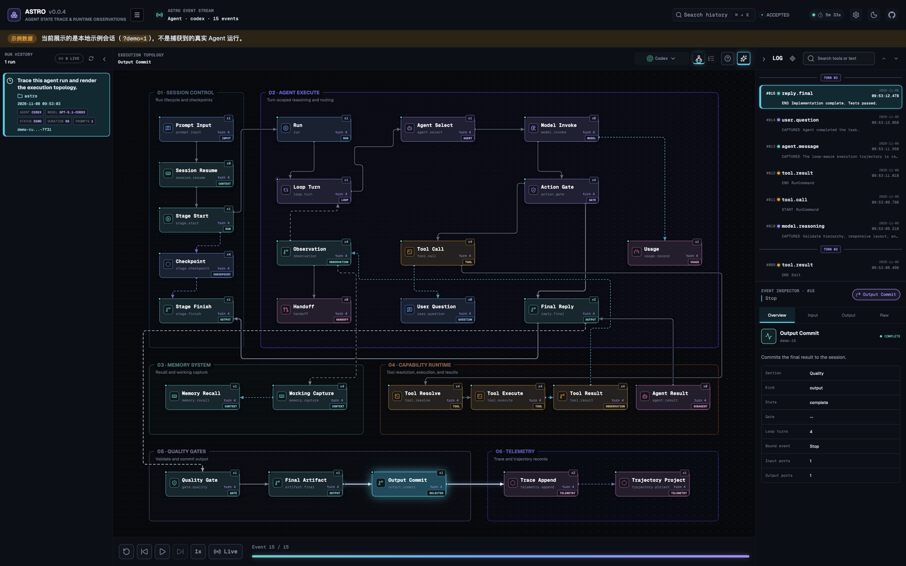
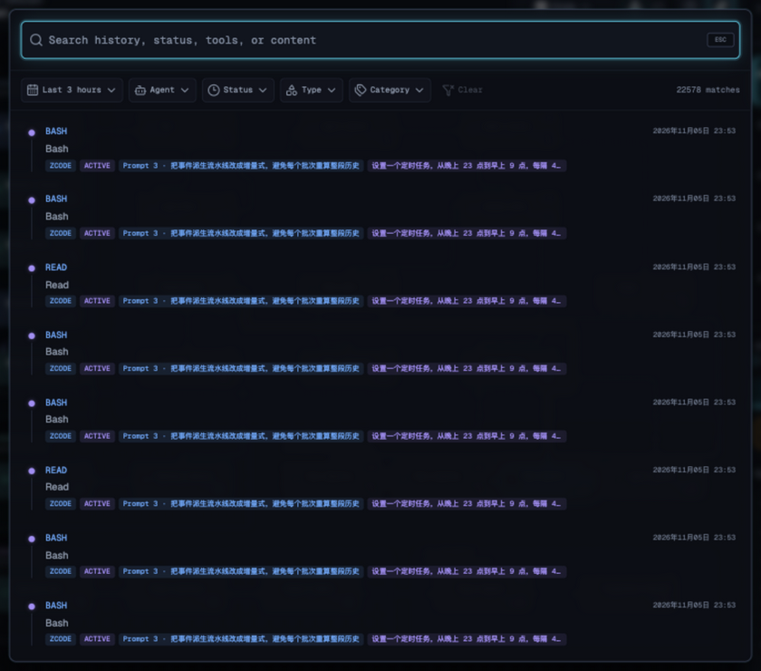
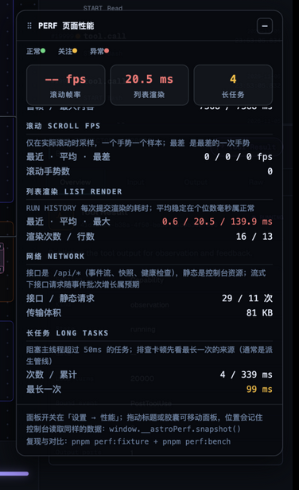

# ASTRO User Manual

> Default URL: `http://127.0.0.1:5678`
>
> Default data root: `~/.astrox` for all clients
>
> Scope: this manual uses the PC desktop console as its default and only interface context.

## 1. What It Does

**ASTRO** means **Agent State Trace & Runtime Observations**. It is unrelated
to the Astro web framework.

ASTRO captures, inspects, and replays coding-agent runtime events on the local machine. Typical uses include:

- reviewing prompts, model activity, tools, notifications, and final responses in one run;
- understanding tool execution, observations, memory, quality gates, and output through an execution topology;
- inspecting tool input, output, duration, and raw payload;
- replaying a historical session to locate the state before a failure;
- using one event model across Trae, Claude Code, Codex, DeepSeek Harness, WorkBuddy, browser clients, and custom integrations;
- importing, exporting, and sharing one run as JSONL.



Both side panels are open in the screenshot. The four primary regions are:

| Region | Visible information | Supported actions |
| --- | --- | --- |
| Left `RUNS` | Source, session, initial and follow-up prompt runs, event count, status, duration, and model (when reported) | Expand prompt runs, switch sessions, and isolate one turn |
| Center canvas | Execution Topology or Run Trajectory, atom states, domain boundaries, and routed edges | Switch platform and view, enable Deep View, select or locate atoms, and open Flow Guide |
| Right `EVENTS` | Time-ordered event log plus Overview, Input, Output, and Raw JSON for the selection | Search events, locate an event, inspect tool arguments and results, and read the normalized payload |
| Replay footer | Current event position, progress, and Live state | Restart, step backward, play or pause, step forward, seek, and change playback speed |

Cyan marks the current selection, violet marks running state, teal marks
completion, and red marks failure or termination. Edge color and line style
distinguish execution, data, feedback, and persistence relationships; Flow Guide
contains the complete legend.

## 2. Requirements

- A current Node.js LTS release with native ESM support;
- `pnpm` activated through Corepack;
- A browser with ES modules, Web Workers, SSE, ResizeObserver, and modern CSS;
- An available loopback port, starting with `127.0.0.1:5678`.

## 3. Install and Start

Recommended:

```bash
corepack enable
pnpm install
pnpm typecheck
pnpm build
pnpm start
```

The server prints its actual URL and data root. If port `5678` is occupied, it
automatically tries later ports, up to 20 additional values. This path runs the
production build or supports manual service management. Direct hook installation
starts and opens the dashboard immediately; `SessionStart` ensures it is open
for each new Agent session.

Development mode uses separate API and Vite processes. Vite reads the same
`ASTRO_HOST/ASTRO_PORT` environment and defaults to `127.0.0.1:5678`:

```bash
# Terminal 1: API
ASTRO_HOME="$HOME/.astrox" pnpm start

# Terminal 2: frontend
pnpm dev
```

For another API port such as `4320`, set the same `ASTRO_PORT` for both processes.

## 4. Quick Start

### 4.1 Explore the Demo

In `pnpm dev` development mode, the console renders a Demo session when the
real event count is zero. This exercises topology, trajectory, inspection, and
replay without installing hooks. Test mode follows the same policy.

The sample run is not part of the bundle: it is the local resource file
`data/demo-events.json`. The service reads that file and serves it as
`GET /api/demo-events`; the console turns it into events. Event times are
offsets from the moment the dataset is loaded (milliseconds), so the sample
always lands inside the hours-based RUN HISTORY window, and editing the file
takes effect on the next page load without a rebuild. Set `ASTRO_DEMO_EVENTS`
to point at a different file (absolute, or relative to the repository).

When the service is unavailable — a purely static deployment, for example —
the console falls back to the same document copied to
`/data/demo-events.json` at build time. If neither source answers it keeps the
truthful empty state and reports `示例数据不可用`; it never presents synthetic
data as captured evidence.

The production output from `pnpm build` never requests or shows Demo data. With
no real events it preserves a truthful empty state.

### 4.2 Capture Agent Activity

Run these commands from the ASTRO repository after completing the
build in section 3.

For native plugin installation, first synchronize the embedded recorders,
server, and built dashboard:

```bash
pnpm build:native-plugins
```

Then install the Codex plugin through the repository marketplace:

```bash
codex plugin marketplace add /absolute/path/to/astro
codex plugin add astro@astro-local
```

Claude Code can load its native package directly:

```bash
claude --plugin-dir /absolute/path/to/astro/claude-plugin
```

It can also be installed through the repository marketplace:

```bash
claude plugin marketplace add /absolute/path/to/astro
claude plugin install astro@astro-local --scope user
```

The sections below describe the direct Hook installer, which remains useful
for Trae and environments where native plugin installation is unavailable.

#### 4.2.1 Codex

Install the current-user hook in `$CODEX_HOME/hooks.json`:

```bash
pnpm install-plugins -- --clients=codex
```

For a non-default Codex home:

```bash
pnpm install-plugins -- --clients=codex --codex-home=/path/to/.codex
```

Restart Codex, run `codex` from the project to observe, and create a new
session. Live events are appended to `~/.astrox/codex/YYYY/MM-DD/HH_mm_ss-<sessionId>/events.jsonl`. Import
existing active and archived rollout files with:

```bash
pnpm import-codex
```

#### 4.2.2 Claude Code

Install project-local hooks:

```bash
pnpm install-plugins -- \
  --clients=claude \
  --scope=project \
  --target=/absolute/path/to/workspace
```

This writes `<workspace>/.claude/settings.local.json`. Install for every
project owned by the current user with:

```bash
pnpm install-plugins -- --clients=claude --scope=user
```

The user-scoped configuration is `~/.claude/settings.json`. Restart Claude
Code, run `claude` from the observed project, and create a new session. Events
are appended to `~/.astrox/claude/YYYY/MM-DD/HH_mm_ss-<sessionId>/events.jsonl`.

#### 4.2.3 DeepSeek Harness

After installing the official `dsh` launcher, add the ASTRO bundle to the
profile you want to observe:

```bash
pnpm install-plugins -- --clients=deepseek --deepseek-profile=web
```

The installer falls back to `npx --yes @deepseek-ai/dsh` when `dsh` is not on
PATH. Use `--dsh-home` for a custom home and `--deepseek-command` for a custom
executable. Restart `dsh web` after installation. Events are appended to
`~/.astrox/deepseek/YYYY/MM-DD/HH_mm_ss-<sessionId>/events.jsonl`.

#### 4.2.4 Trae

Install project-local hooks:

```bash
pnpm install-plugins -- \
  --clients=trae \
  --target=/absolute/path/to/workspace
```

This writes `<workspace>/.trae/hooks.json`. Reopen or reload that workspace
in Trae, then start a new Agent conversation. Events are appended to
`~/.astrox/trae/YYYY/MM-DD/HH_mm_ss-<sessionId>/events.jsonl`.

#### 4.2.5 View the run

By default, installation starts and opens the dashboard immediately. After a
client reload or restart, `SessionStart` records the current Agent session,
checks `<data-root>/dashboard-<port>.pid`, and starts the service in the
background when it is not running. Whether the browser opens follows the
preview page's opened state, which the service records as
`preview-state.json` under the data root the moment a console page attaches to
its event stream: a page that was never opened gets opened with the current
session selected (the hook opens it once if the service already runs), and
afterwards no new tab pops up. If `5678` is occupied, the browser opens the
selected later port.

To manage the process manually, disable automatic startup and use either
entry point:

```bash
ASTRO_AUTO_OPEN=0 pnpm start
# All clients share the user-level runtime and data root.
node ~/.astrox/plugins/astro/server/server.mjs
```

Select the session in **Run History** and choose the matching platform. Hooks
keep recording while the dashboard is stopped; the dashboard is only required
for the UI and live SSE updates. Set `ASTRO_AUTO_OPEN=0` in the client process
environment to keep prompt-triggered startup disabled.

Install the hook-based clients in one operation with
`pnpm install-plugins`; install the DeepSeek bundle explicitly with
`--clients=deepseek`.
Existing hook commands are preserved. Use `--no-migrate` to skip legacy data
migration or `--astro-home=/path/to/.astrox` to change the data root.

### 4.3 Deploy a preview page (Vercel / GitHub Pages)

The console is a static page, so it can be deployed to Vercel or GitHub Pages
and watch agent runs happening **on your machine**: the page lives in the
cloud, the data still comes from the ASTRO service on your computer. The full
deployment reference (CORS, data directory, `astrox` commands,
troubleshooting) lives in the [Deployment Guide](deployment-en.md).

Deployment paths:

| Path | How |
| --- | --- |
| Vercel | The repository's `vercel.json` is already wired: it builds the console and the docs site and merges them (docs at the root, the console at `/console/`). Import the repository — no extra settings. |
| GitHub Actions | `.github/workflows/console-preview.yml` builds the console on push/PR and uploads a `console-dist` artifact; run "Deploy console preview to GitHub Pages" manually from the Actions tab to publish the **current branch's** build to GitHub Pages (no main merge required; the single shared Pages site is republished by the most recent dispatch) |
| Any static host | `pnpm build` produces `dist/` with relative asset URLs; serve it as-is. |

A deployed page defaults to `http://127.0.0.1:5678`; pass `?api=<address>` to
point it elsewhere (the value is persisted as `ASTROX_API_BASE`, so later
visits need no parameter; an empty `?api=` clears it). Use the URL the service
prints at startup — if the port moved, point `?api=` at the actual one.

Two things must hold before the page can connect:

1. **The service is running**: installation starts it on the first prompt, or
   run `pnpm start` manually.
2. **The service allows the page's origin**: cross-origin reads are off by
   default (same behavior as every earlier release). Start the service with an
   allowlist:

   ```bash
   ASTRO_CORS_ORIGINS="https://<your-deployment-domain>" pnpm start
   ```

   An installed runtime started by a hook has no terminal to carry that
   variable, so put the allowlist in `~/.astrox/plugins/astro/config.yaml`
   under `server.corsOrigins` (or `ASTRO_CORS_ORIGINS` in the `.env` next to
   it), then restart the local service from Settings → About. The list loads
   with the service and survives every later launch:

   ```yaml
   server:
     corsOrigins:
       - https://chaos-design.github.io
   ```

   Separate multiple origins with commas; `/api/health` reports the active
   list as `corsOrigins`. Chrome additionally requires the service to answer
   the Private-Network preflight (`Access-Control-Allow-Private-Network`),
   which the service returns automatically for allowlisted origins.

Once connected, behavior matches the local console: every prompt writes new
events to the local JSONL files, the service pushes them over SSE, and RUN
HISTORY, the topology and the trajectory update live; disconnects reconnect
and repair with a snapshot. The first snapshot covers only the console's
current range (three hours by default); older history is fetched by
`LOAD EARLIER` with a wider window. A large local history therefore no longer
forces the service to serialize everything before the first paint, and live
events never queue behind one enormous transfer.

About the sample dataset: the `data/demo-events.json` file ships with the build
output too (`deploy/console/data/demo-events.json`) and can be read by your
local service over `GET /api/demo-events`. A deployment is a production build,
so by default it does **not** render that sample as captured evidence
(`shouldShowDemo` only auto-applies in development/test) — the preview page
defaults to showing your machine's real agent runs.

If your machine has no data yet and you want to try the console on the deployed
page, append `?demo=1` (e.g. `https://<deployment-domain>/console/?demo=1`) to
open the sample session: the page reads the sample through the configured
local-data address (`?api=`, default `http://127.0.0.1:5678`), or falls back to
the static copy shipped with the deployment when the service will not answer,
and keeps a persistent "sample data" banner below the header so you always know
you are viewing a sample, not captured evidence. It is an **explicit switch**,
not an implicit fallback — drop the parameter and the page returns to its
truthful empty state. The sample also only ever renders with zero captured
events and never overrides real data.

Security note: `ASTRO_CORS_ORIGINS` is the cross-origin read boundary for your
local traces. List only deployment domains you control; do not set `*`. The
page must be `https://` or a loopback address — browsers treat `127.0.0.1` /
`localhost` as trustworthy, which is what lets an HTTPS page read the local
HTTP service.

## 5. Console Tour

### 5.1 Header

- Product identity: `ASTRO`.
- Action menu: import, export, and clear.
- `ASTRO EVENT STREAM`: current source and event count.
- Search History: opens global search; `Cmd/Ctrl + K` is the keyboard shortcut.
- Connection state:
  - `connecting`: the first stream connection is still being established; the
    snapshot has not arrived yet, so this is not a failure;
  - `accepted`: SSE connected but no event received yet;
  - `synced HH:MM:SS`: connected, followed by the capture time of the newest event;
  - `offline`: a connection was established and then dropped;
  - `demo`: development/test mode is rendering the local sample dataset
    (`data/demo-events.json`) because the real count is zero.
- The icons on the right read, left to right: settings (gear), theme, GitHub.
  GitHub is always the right-most one, because it is the only header control
  that leaves the console.
- GitHub icon: opens the project repository
  (`https://github.com/chaos-design/astro`) in a new tab.
- Settings icon (gear): opens the settings dialog for the default message range
  and the Live filter.
- Theme: light, dark, or system; stored in `ASTROX_THEME`.
- Service chip (the local service's uptime): opens the service card with the
  console/service versions, process details, session counts, the data directory
  and "restart local service". The "change" control next to the data directory
  accepts another existing absolute path (or `~/…`); "save and restart" writes
  it to the installed runtime's `.env` (`ASTRO_TRACE_DIR`) and restarts, so the
  new process reads that directory and later recorder sessions write there too.

### 5.2 Global History Search

Open Search History from the header or press `Cmd/Ctrl + K`. It searches every
event already loaded in the browser, not only the currently selected Prompt.
The dialog opens on the default time range from Settings — the last three hours
unless changed; a range picked inside the dialog applies to that search only.
It also opens **scoped to the agent the page is currently on**: the Agent filter
is pre-selected to that agent, so results read as "this agent's history" rather
than the whole machine's; picking a different agent inside the dialog still
applies to that search only.

Available filters include:

- 3, 6, 12, or 24 hours, today, yesterday, seven days, or a custom date range;
- one or more agents: the list contains configured agents only; every other
  source (browser, generic, a custom HTTP collector) is grouped under the
  trailing **Others** entry instead of getting a pseudo-agent of its own;
- one or more run statuses;
- one or more event categories.

Filters combine across groups. Text matching is case-insensitive and supports
exact substrings and ordered fuzzy matches. The result list loads more entries
automatically as it scrolls — appends render only the new rows and are
scheduled at lower priority, so scrolling a long list never re-renders the
rows already on screen.



Selecting a result switches to the matching platform when available, selects
the parent Session and Prompt run, opens History and Events, selects the exact
event and mapped atom, exits replay, and locates the topology and LOG rows.
Global History search covers loaded browser data. Server-side `/api/search`
remains a separate API.

### 5.3 Run History

On the first load (and on every refresh) the panel paints four placeholder rows
and the header reads `loading…` instead of reporting `0 runs` and then jumping
to the real count. On a large history the skeleton stays until the snapshot has
been processed; during that time the list, the canvas and the log no longer
flash an empty state first.

The list is narrowed to the selected agent and then windowed — the agent is the
outer filter, and the intersection of the two is what the list shows. The window
length is the default time range from Settings (three hours unless changed),
measured back from the **newest message** rather than from the wall clock:
opening the console after a night away still shows the messages around the last
session instead of an empty list. When older runs remain, `LOAD EARLIER`
appears at the bottom; clicking it — or scrolling to the bottom — doubles the
window (3 → 6 → 12 → 24 → 48 hours) until nothing older is left. The service
ships only the **requested window** (a live session keeps its full history), so
a large history no longer transfers everything before the first paint;
`LOAD EARLIER` re-subscribes with the wider window and replaces the loaded
events instead of only widening a local filter.

Executing messages ignore the window: they are always listed and always pinned
to the top — within the selected agent. When several execute at once they are
ordered by their **newest message's start time**: the message that began
executing last sits on top, and each row's position is stable while its
message runs (no shuffling as events keep arriving) — only a newly sent
prompt takes the top. A message executing under another agent is not part of
this list; the agent picker signals it instead, with a pulsing dot on the
agent that is running, and switching to it shows the message.
Switching agents also moves the canvas, the log and the selection onto the new
agent's newest message rather than leaving the previous run on screen.

The `N LIVE` chip in the panel header toggles the Live filter:

- Armed, it lists **only the messages whose run is executing right now**. The
  filter reads the selected agent's whole history (the time window is dropped,
  so a session that started days ago and was just prompted again qualifies),
  but finished messages are not listed, and the chip turns into a dark filled
  pill with light text while keeping its radar glyph (disarmed it is a light
  outlined pill). Executing messages are pinned, expanded and scrolled into
  view. When a message is sent, the run that newly
  starts executing is located automatically — no hunting through the list.
- With nothing executing the chip reads `0 LIVE` and the list is empty, with a
  "nothing is executing right now" message and the way out. That is a normal
  filter result; it never falls back to the full history.
- Disarmed, the list returns to the default window and `LOAD EARLIER` returns.
- The choice is stored in `ASTROX_RUN_HISTORY_LIVE_VIEW` and is off by default
  (Settings can change that default): a filter may legitimately match nothing,
  so arming it on load would open the console on an empty panel.

The status marker in the header describes the event stream itself:

- `synced HH:MM:SS` — connected, followed by the capture time of the newest
  event; `accepted` means connected with no events yet;
- `connecting` — the first connection is still being established. Before the snapshot arrives the header no longer claims `offline`: "not connected yet" and "cannot connect" are different states;
- `restarting` / `reloading` — a local service restart or a full snapshot reload is in progress. Neither is a dropped connection: the marker returns to `synced` on its own;
- `offline` — the connection dropped and the list may be stale; the browser
  keeps retrying;
- `paused` — the **max sync time** has been reached (eight hours by default,
  Settings → Run history), so the console has deliberately stopped accepting
  new events to keep a long-open page from accumulating memory. Clicking the
  marker reloads the current snapshot and restarts the clock; restarting the
  local service does the same. The pause is announced once with a notice that
  names the cause and the way back.

**After a local service restart** the console drops its resume cursor, pulls the
full snapshot again and applies the current filter to it — agent, default range
and the Live filter — landing on that filter's newest message. Sessions written,
removed or rewritten while the service was down show up in the list. When the
history did not change, the service answers with a "same snapshot" confirmation
instead of the body, so the page transfers no JSON, parses nothing, and keeps
its list and canvas exactly as they were.

The agent list comes from the toolbar platform dropdown: the configured agents
are listed first and a trailing **Others** catch-all collects runs whose source
is not a configured agent. Selecting a configured agent also switches the
topology platform; selecting **Others** leaves the platform unchanged.

Each parent row represents one session and shows:

- active, complete, or failed status;
- title derived from the first user prompt;
- start time;
- source platform;
- duration; active sessions refresh once per second, default to a 24-hour live
  cap, and become `terminated` when that cap is reached;
- prompt count;
- abbreviated session ID.

Sessions with multiple prompts expand automatically when selected. Their child
rows are labeled `INITIAL` and `FOLLOW-UP 01`, `FOLLOW-UP 02`, and so on.
Each child shows that prompt's title, status, start time, duration, event count,
and abbreviated prompt event ID. The session row shows the model of its latest
message, and each child row shows its own message's model — when the client
recorded the model the run executed on, the row adds a `MODEL` tag next to
`AGENT` (and the hover card shows it too): pi and deepseek carry a structured
`model`/`provider` on `AgentMessage`, opencode carries `model` on its step
notification (older captures are read from the message text), and ZCode
reports its session's model on `SessionStart` — if the model is switched
mid-session, later messages still show the session-start model. A mid-run
model switch shows the last observation. Clients that do not report a model
(for example the claude and codex hooks) show no tag — an unreported model is
not rendered as "unknown". A prompt run begins with one
`UserPromptSubmit` and contains every following event before the next prompt.

Click a child row to make that prompt run the active diagnostic scope. Clicking
the parent selects its latest prompt. Only one session thread is expanded at a
time. The child list is measured to its content (300 px ceiling; a two- or
three-message thread expands in full), scrolls independently, and keeps the
selected child visible. Expanding and collapsing animate; a collapsed child
list takes no space, and a single-prompt session has no child list at all (the
parent row *is* that message). The left panel can collapse to a `RUNS` rail to
give the topology more desktop workspace.
The expanded state is stored in `ASTROX_HISTORY_OPEN` and restored after refresh.

### 5.4 Main Workspace

The workspace renders the selected prompt run. It provides:

- **Execution Topology**: semantic atoms grouped into domains;
- **Run Trajectory**: observed steps grouped by turn and Input / Model / Tools lanes.

Toolbar controls:

- platform context: Codex, Claude Code, Trae, and other configured agents,
  plus an **Others** catch-all;
- topology/trajectory switch;
- atom and edge guide;
- all atoms/runtime atoms switch;
- open event panel.

Platform switching does not change raw events. All supported platform contexts
preserve the same stable 27-atom semantics.
The agent dropdown also narrows Run History to the selected agent.
The platform choice is stored in `ASTROX_PLATFORM`.

### 5.5 Event Panel

The upper LOG area:

- orders the newest event first;
- groups rows by turn;
- searches any serialized field in the selected prompt run; matching follows
  the keystroke in the background (per-event serializations are cached, so
  typing stays smooth on long runs);
- selects or clears an event by clicking its row;
- locates the mapped atom in the topology;
- puts the top/bottom scroll controls in the panel header (only the edge that is
  actually out of view shows a control), so no floating button ever covers the
  first visible atom.

The inspector provides:

- `Overview`: state, source, type, time, tool, and call ID;
- `Input`: tool input or prompt;
- `Output`: tool result or response;
- `Raw`: full normalized event;
- copy control for structured JSON.

Selecting a topology atom additionally exposes the atom contract, input/output ports, gate state, and bound event.
The right panel state is stored in `ASTROX_CONSOLE_OPEN`.

### 5.6 Session Status

- `active`: the latest turn has no completion, failure, or termination signal;
  duration updates every second until the configured timeout.
- `complete`: the latest `Stop` is not older than the latest prompt; `Stop` completes only one response.
- `failed`: a failure follows the latest prompt or completion marker.
- `terminated`: an abort, cancellation, `Interrupt`, `SessionEnd`, a newer
  session in the same workspace, or the 24-hour default live timeout ends it.

Timeout termination is an effective UI state. It caps the displayed duration
and stops live animation but does not modify stored events.

A later `UserPromptSubmit` with the same `sessionId` reactivates a completed
session. Follow-up questions continue in that session without a page refresh
and appear as separate child runs. While Live is active, a newly arriving prompt
becomes the selected child automatically. Older child runs remain stable and
can be inspected without receiving later events.

### 5.7 Reading a Timeout in the Console

The same timeout result is applied consistently across the selected diagnostic
scope:

| Surface | Before timeout | At and after timeout |
| --- | --- | --- |
| Session or Prompt status icon | active/waiting color and icon | red `terminated` icon |
| Duration | advances once per second when eligible | fixed at the configured limit |
| Topology | latest active atom and transition may animate | no live transition animation |
| Event log | latest executing row may show a running marker | running marker stops |
| Replay and inspector | available | still available; evidence is not deleted |
| Export | exports original selected events | unchanged |

The timeout does not prove that the external agent process was killed. It means
ASTRO no longer treats that recorded interval as a live execution. Check the
source client and the latest JSONL event when process state matters.

Parent and child rows can differ by design. The Session parent advances only
while its latest Prompt is `active`; a waiting latest Prompt freezes the parent.
The waiting child continues its own duration and can independently reach the
timeout. A historical complete, failed, or terminated run keeps its recorded
duration even when it is longer than the current limit.

### 5.8 Settings

The gear in the header opens the settings dialog. It is a two-pane card: a
section rail on the left (Appearance, Run history, Canvas, Panels, Performance,
About) and
the active section's fields on the right. Every entry applies immediately, and
the footer's **Done** button only closes the dialog — there is no Apply step:

**Appearance**

- **Theme**: light / dark / system — the same preference as the header switcher
  (`ASTROX_THEME`).

**Run history**

- **Default time range**: hour choices on one row, day choices on the
  next (eight total) — `1 hour`, `3 hours`
  (default), `6 hours`, `12 hours`, `1 day`, `3 days`, `5 days`,
  `7 days`. It drives RUN HISTORY's visible window (while the Live filter is
  off) and the initial range of the global search dialog; the window is
  measured back from the newest message, so opening the console the next
  morning still shows the last session.
- **Live filter**: off by default. When on, the console opens with the Live
  filter armed (the same state as pressing the `N LIVE` chip), so RUN HISTORY
  lists only the executing messages of the selected agent — and nothing at all
  while that agent is idle. It ignores the time range above.
- **Max sync time**: how long the console keeps consuming the event stream —
  `8 hours` by default (`1` / `4` / `8` / `12` / `24 hours`, or `No limit`).
  When it runs out the stream is closed and no new event is accepted; the header
  marker turns from `synced` to `paused`. Clicking that marker, or restarting
  the local service from its card, reloads the current snapshot and restarts
  the clock.

**Canvas**

- **Default view**: topology / trajectory (`ASTROX_ACTIVE_VIEW`).
- **Runtime atoms only**: hide atoms that take no part in this execution
  (`ASTROX_DEEP_VIEW`).

**Panels**

- **Expand RUN HISTORY** and **Expand EVENTS**: the two columns' expanded state
  (`ASTROX_HISTORY_OPEN` / `ASTROX_CONSOLE_OPEN`).

**Performance**

- **Performance panel**: floats a diagnostics panel (scroll fps, list render,
  long tasks) at the bottom of the page, off by default (`ASTROX_PERF_HUD`).
  Toggling it mounts and removes the panel immediately; the dropped position
  persists across visits. The old `?perf=1` parameter is retired — a browser
  that stored it is honoured once on first load, after which this switch owns
  the state. See "The Performance Panel" below.

**About**

- The console version (`v0.0.3`), where the preferences actually live (browser
  localStorage under the `ASTROX_` prefix), and a note that settings only affect
  presentation and never rewrite captured events.

The values are written to `ASTROX_HISTORY_RANGE`, `ASTROX_RUN_HISTORY_LIVE_VIEW`,
`ASTROX_MAX_SYNC`, `ASTROX_PERF_HUD` and the other keys above. **Reset**
restores every section at once (3 hours, Live off, an 8-hour sync window,
dark, topology, runtime atoms only, the performance panel off, and the
width-based panel defaults).

## 6. Execution Topology

### 6.1 Nodes

Each node includes:

- idle, running, complete, or failed status;
- matching event or atom-instance count;
- atom label;
- stable atom key;
- turn count where available;
- atom kind or `INFERRED`.

Click a node to select it and synchronize the inspector. Click the same node again to clear selection.

### 6.2 Edges

Edge responsibilities include:

- main execution flow;
- reasoning loop;
- capability invocation;
- record and telemetry flow;
- subagent delegation and return;
- user question or permission interaction.

When the active atom changes, animated particles show the resolved transition path. Selecting an atom highlights directly connected edges.

### 6.3 Full and Runtime Views

The Sparkles control switches between:

- **All atoms**: all 6 domains and 27 atoms;
- **Runtime atoms**: the frequent runtime semantics only.

Use all atoms for architecture, tool internals, or output-quality analysis. Use runtime mode to reduce density during live monitoring.

### 6.4 Atom Guide

The question-mark control slides a guide in from the right and dims the console
behind it, so the drawer reads as a layer over the workspace instead of a fourth
column:

- edge semantics;
- one tab per domain;
- localized name, stable key, purpose, and I/O counts;
- click-to-locate behavior for every base atom.

## 7. Trajectory View

Trajectory prioritizes observed time order over the complete semantic
architecture and uses only the selected prompt run.

The summary displays:

- turn count;
- step count;
- completed count;
- failed count.

The lane map uses Input, Model, and Tools. The detailed list groups steps by turn and shows event type, summary, timestamp, duration, and status.

Matching `PreToolUse` and `PostToolUse` or `PostToolUseFailure` events with the same `toolUseId` become one tool step. Expand a row to inspect paired input and output.

## 8. Replay

The footer provides:

- restart;
- previous event;
- play/pause;
- next event;
- `0.5x`, `1x`, `2x`, and `4x`;
- `Live` to return to the latest event;
- a range control for direct seeking.

Replay rebuilds the selected prompt run from the prefix ending at the cursor:

- trajectory steps;
- atomic instances;
- always-visible stable edges and their runtime state;
- active atom and transition;
- selected inspector event.

Replay never modifies or appends trace data.

## 9. Import, Export, and Clear

Open the header action menu.

### Import Run

Accepted formats:

- JSON arrays;
- JSONL with one object per line;
- normalized event envelopes;
- raw hook-like payloads.

Imported events remain in browser memory and are not written to server JSONL. Duplicate IDs already imported into the page are ignored.

The outcome is reported by a notice in the bottom-left corner: a success notice
names the event count and the file, a failure notice names the reason (for
example, the file is not valid JSON). A well-formed file that carries no events
is reported too, instead of silently importing nothing.

### Export Run

The selected prompt run is downloaded as:

```text
astro-<source>-<sessionId>-prompt-<number>.jsonl
```

Each line is a complete normalized event from that prompt interval. A session
without `UserPromptSubmit` events falls back to a session-level export named
`astro-<source>-<sessionId>.jsonl`.

### Clear Local Events

After confirmation, the action:

- clears imported events in the page;
- sends `DELETE /api/events` outside demo mode;
- truncates the server JSONL and resets live memory.

The action is destructive. Export any required sessions first. Success and
failure are both reported by a notice, so a failed clear no longer ends in a
native browser alert.

## 10. Deep Links

The page writes the current selection into:

```text
?agent=codex&session=<sessionId>&event=<eventId>
```

`agent` mirrors the dropdown filter (a configured agent id or `others`).
Opening the URL selects the matching agent, session, containing prompt run,
and event when that trace data exists in the target environment. Legacy
`?source=` links keep working.

## 11. Import Codex History

Import active and archived sessions from the default Codex home:

```bash
pnpm import-codex
```

Import selected rollouts:

```bash
node bin/astro.mjs import-codex /path/to/rollout.jsonl
```

Use another Codex home:

```bash
node bin/astro.mjs import-codex --codex-home=/path/to/.codex
```

Deterministic IDs make unchanged imports idempotent.

## 12. CLI

```text
astro-trace serve
astro-trace install [--target DIR] [--clients trae,claude,codex,deepseek,workbuddy] [--scope user|project]
astro-trace update [--no-deepseek] [--astro-home DIR]
astro-trace doctor [--target DIR] [--scope user|project] [--deepseek-profile NAME]
astro-trace migrate [FILE_OR_DIR] [--astro-home DIR]
astro-trace import-codex [FILE ...] [--codex-home DIR]
astro-trace ingest [FILE] [--source NAME]
```

`astro-trace update` refreshes the already-installed plugin runtime in place
(recorder, `runtime-config`, `storage-paths`, bundled vendor dependencies, the
`dist` and `server` bundles, and the DeepSeek plugin) without touching hook
configurations, `.env`, or captured trace data. Use it after pulling a newer
build; re-run `astro-trace install` only when you also need to refresh hooks
or migrate data.

Ingest generic JSONL from a file:

```bash
node bin/astro.mjs ingest ./trace.jsonl --source custom-agent
```

Ingest from standard input:

```bash
printf '%s\n' \
  '{"sessionId":"s1","eventName":"AgentMessage","payload":{"message":"Done"}}' \
  | node bin/astro.mjs ingest --source custom-agent
```

### 12.1 astrox plugin control

`astrox` is a thin control CLI for the ASTRO plugin: it wraps starting and
stopping the dashboard daemon, refreshing the plugin runtime, and inspecting
status and trace data. Diagnostics, installation, and migration delegate to the
underlying `astro-trace` shown above.

```text
astrox start [--port N] [--host H] [--open] [--no-global] [--bin-dir DIR]
astrox stop
astrox restart
astrox status [--json] [--deepseek-profile web]
astrox info [--json]
astrox update [--no-deepseek]
astrox doctor [options]        run the full astro-trace diagnostics
astrox install [options]       install or refresh hook integrations
astrox migrate [FILE_OR_DIR]   migrate legacy trace data
astrox open                    open the running dashboard in a browser
astrox logs [--lines N]        tail the dashboard log
astrox path                    print ASTRO home, plugin dir, and CLI entry
```

- `start` launches the dashboard daemon (default `127.0.0.1:5678`). It also
  registers this entry as the global `astrox` command: on Unix it symlinks into
  the first writable of `/usr/local/bin`, `~/.local/bin`, or `~/bin`; on Windows
  it writes `%USERPROFILE%\.astrox\bin\astrox.cmd`. An existing symlink already
  pointing at this entry is reused, while one pointing elsewhere is left alone.
  `--no-global` skips registration; `--bin-dir DIR` overrides the candidate
  directories; `--open` opens the browser after launch.
- Once launched, the daemon writes `<ASTRO_HOME>/dashboard-<port>.pid` (with
  `pid` and `url`); the run log lands at `<ASTRO_HOME>/dashboard.log`.
  `logs [--lines N]` tails the last 40 lines by default.
- `stop` sends `SIGTERM` (then `SIGKILL` if needed) to the daemon and clears the
  process; no extra cleanup runs. `restart` is `stop` followed by `start`.
- `status` summarizes the plugin config (config.yaml / .env as OK, WARN, or
  MISSING), the global CLI state, the dashboard run state, and per-client hook
  integrations (codex, claude, workbuddy, trae, deepseek). `--json` emits a
  machine-readable report.
- `info` lists each source's trace file count and byte total (claude, codex,
  copilot, cursor, deepseek, gemini, iflow, llama, opencode, pi, qwen, trae,
  workbuddy, zcode, …) plus the trace root, plugin directory, and global CLI
  path. `--json` behaves the same.
- `update` refreshes the installed plugin runtime in place (equivalent to
  `astro-trace update`); `--no-deepseek` skips the DeepSeek plugin package.

> The control commands require an installed plugin runtime; run `astrox install`
> (or `astro-trace install`) first.

## 13. HTTP API

### 13.1 Health

```bash
curl http://127.0.0.1:5678/api/health
```

### 13.2 Ingest One Event

```bash
curl -X POST http://127.0.0.1:5678/api/events \
  -H 'Content-Type: application/json' \
  -H 'X-Astro-Source: custom-agent' \
  -d '{
    "sessionId": "s1",
    "eventName": "AgentMessage",
    "payload": {
      "message": "Done"
    }
  }'
```

### 13.3 Batch Ingestion

Send a direct array:

```json
[
  {
    "sessionId": "s1",
    "eventName": "SessionStart",
    "payload": {}
  },
  {
    "sessionId": "s1",
    "eventName": "Stop",
    "payload": {
      "message": "Done"
    }
  }
]
```

Or:

```json
{
  "events": []
}
```

### 13.4 Read and Search

```text
GET /api/events
GET /api/events?source=codex&session=<sessionId>
GET /api/events/<eventId>
GET /api/search?q=<query>
GET /api/search?q=<query>&source=codex&session=<sessionId>
GET /api/stream
GET /api/demo-events
```

The server search scans nested fields. The current UI LOG search filters only
the selected prompt run, or the session fallback when no prompt exists, and
does not call `/api/search`.

Every initial or reconnected `/api/stream` connection receives a complete
`reset`, then `ready`, and then new `trace` events. The server advertises a
one-second retry, so follow-up turns emitted during disconnection are repaired by
the reconnect snapshot.

`/api/demo-events` serves the console's sample dataset
(`{ path, cached, eventCount, dataset }`); a missing file answers 404 and a
malformed one 500. `/api/health` reports the active cross-origin allowlist as
`corsOrigins`. Both support the deployed preview page: it targets
`http://127.0.0.1:5678` by default, and the allowlist is described in
section 4.3.

### 13.5 Service management

```text
DELETE /api/events                 clear all captured events
POST /api/restart                  in-place restart (successor keeps the same port, SSE reconnects)
POST /api/config/data-root         {"path": "/abs/path"} change the data directory
```

`POST /api/config/data-root` writes the data directory into the plugin `.env`
(every other line preserved, missing or relative paths rejected), then restarts
in place; `/api/health` reports the resulting `dataRoot`. The console's
"data directory → change" card is this endpoint. The same jobs can be done from
the shell with `astrox restart` / `astrox update`. The full server endpoint and
environment reference lives in the [Deployment Guide](deployment-en.md).

## 14. Browser SDK

```js
import { createAstroClient } from "./plugin/browser-client.js";

const trace = createAstroClient({
  source: "browser",
  workspaceId: "my-extension",
});

await trace.startSession({ extension: "my-extension" });
await trace.submitPrompt("Inspect the current page");

const call = await trace.startTool(
  "querySelector",
  { selector: "main" },
);

await trace.finishTool(
  "querySelector",
  call.toolUseId,
  { matches: 1 },
);

await trace.agentMessage("Inspection finished");
await trace.stop({ message: "Done" });
```

The default endpoint is `http://127.0.0.1:5678/api/events`. Browser extension background processes must declare loopback host permission.

## 15. Configuration

Installation creates the shared active files under the installed plugin:

```text
<ASTRO_HOME>/plugins/astro/config.yaml
<ASTRO_HOME>/plugins/astro/.env
```

`config.yaml` contains normal typed settings. `.env` contains local or
sensitive values and may be referenced from YAML with `${NAME}` or
`${NAME:-fallback}`. The repository's `config.example.yaml` and `.env.example`
are source templates; they do not directly configure an installed plugin.

The existing environment names remain supported as overrides:

| Variable | Default | Meaning |
| --- | --- | --- |
| `ASTRO_HOST` | `127.0.0.1` | Bind address |
| `ASTRO_PORT` | `5678` | Preferred port |
| `ASTRO_HOME` | `~/.astrox` | Runtime, plugins, and source-specific event files |
| `ASTRO_TRACE_DIR` | unset | Optional relative or absolute shared trace directory; the service card's "data directory → change" writes it to the plugin `.env` |
| `ASTRO_PROJECT_DIR` | current working directory | Base for a relative `ASTRO_TRACE_DIR` |
| `ASTRO_MAX_BODY_BYTES` | `5242880` | Maximum POST body size |
| `ASTRO_CORS_ORIGINS` | unset (cross-origin off) | Deployed-page origins allowed to read the local API (comma-separated; `*` only when explicit); see "Deploy a preview page"; `server.corsOrigins` is the config-file equivalent |
| `ASTRO_DEMO_EVENTS` | unset | Dataset path read by `GET /api/demo-events` |
| `ASTRO_AUTO_OPEN` | `1` | Start and open the dashboard during installation or Agent startup; set `0` to disable |
| `DSH_HOME` | `~/.dsh` | DeepSeek Harness profiles and plugins |
| `DSH_COMMAND` | `dsh` | DeepSeek Harness launcher |
| `CODEBUDDY_HOME` | `~/.codebuddy` | WorkBuddy / CodeBuddy Code settings and plugins |
| `CODEBUDDY_COMMAND` | `codebuddy` | WorkBuddy / CodeBuddy Code CLI used by diagnostics |

`AOT_HOME`, `AGENT_TRACE_*`, and `TRAE_TRACE_*` remain supported only as
deprecated upgrade fallbacks.

Precedence is explicit CLI option, inherited process environment, plugin
`.env`, `config.yaml`, then built-in defaults. `ASTRO_HOME` must be supplied
before installation because it locates the plugin and cannot be set in the
plugin's own `.env`.

The installer creates both files on first installation and preserves them on
upgrade. Edit them directly and restart the Agent or ASTRO process:

```bash
$EDITOR ~/.astrox/plugins/astro/config.yaml
$EDITOR ~/.astrox/plugins/astro/.env
astro-trace doctor
```

The build-time frontend constant `appTimings.activeRunTimeoutMs` in
`src/config/app-config.ts` controls the live timeout and defaults to
`24 * 60 * 60 * 1_000`. After changing it, run `pnpm build` and restart the
static service. Existing JSONL needs no migration because the value controls
only effective display state.

### 15.1 Browser-local Preferences

| Key | Values | Purpose |
| --- | --- | --- |
| `ASTROX_THEME` | `light` / `dark` / `system` | Theme |
| `ASTROX_PLATFORM` | `codex` / `claude` / `trae` | Platform context |
| `ASTROX_HISTORY_OPEN` | `true` / `false` | Left History panel |
| `ASTROX_CONSOLE_OPEN` | `true` / `false` | Right Events/Inspector panel |
| `ASTROX_HISTORY_RANGE` | `1h` / `3h` / `6h` / `12h` / `1d` / `3d` / `5d` / `7d` | Default time range, `3h` unless changed |
| `ASTROX_RUN_HISTORY_LIVE_VIEW` | `true` / `false` | Live filter armed by default, off unless changed |
| `ASTROX_MAX_SYNC` | `1h` / `4h` / `8h` / `12h` / `24h` / `off` | Longest sync window, `8h` unless changed; `off` never stops |
| `ASTROX_ACTIVE_VIEW` | `topology` / `trajectory` | Last canvas view |
| `ASTROX_DEEP_VIEW` | `true` / `false` | Runtime-only atoms in the topology |
| `ASTROX_PERF_HUD` | `true` / `false` | Performance panel on, `false` unless changed |

Legacy `astro-theme`, `astro-platform`, and `astro:perf-hud` values are removed
after the corresponding new key is written: the first two migrate automatically;
`astro:perf-hud` is the on-flag the retired `?perf=1` parameter stored (the value
`"1"`), and a first load still honours it before the switch takes over. Invalid
or unavailable storage falls back to defaults without affecting capture. The old
`ASTROX_RUN_HISTORY_LIVE_FILTER` is not migrated: it meant "show every
message", the opposite of the Live filter, so it is deleted on the next write.

### 15.2 Upgrade from the previous data layout

The old product used `~/.astrox` and, in earlier builds, a project-local
`.agent-trace/events.jsonl`. The direct Hook installer copies both layouts
into `~/.astrox` unless `--no-migrate` is supplied. Native plugin installation
does not run repository migration scripts. Existing
`HH:mm:ss-<sessionId>` directories are renamed to
`HH_mm_ss-<sessionId>` during migration.

Run migration manually when needed:

```bash
node bin/astro.mjs migrate
node bin/astro.mjs migrate ~/.astrox
node bin/astro.mjs migrate /path/to/.agent-trace
node bin/astro.mjs migrate /path/to/events.jsonl
```

Migration is idempotent: existing event IDs are skipped. Imported source files
are retained; a legacy time-formatted directory is removed only after a
successful rename or conflict-safe merge. Verify before removing or archiving
old imported data:

```bash
find ~/.astrox -type f -name events.jsonl -print
curl http://127.0.0.1:5678/api/health
```

## 16. Data Safety and Backup

- The service binds to loopback by default.
- Trace data is stored only in local JSONL by default.
- Sensitive key names and common secret patterns are redacted before persistence.
- Keep `~/.astrox` outside project repositories.
- Review `payload` manually before sharing because rule-based redaction cannot recognize every domain-specific secret.
- Back up `~/.astrox` for complete sessions, or export selected prompt runs
  through the UI.

Do not expose the service through `0.0.0.0` or a public network without authentication and TLS.

## 17. Troubleshooting

### The Performance Panel

Turn on **Performance panel** in **Settings → Performance**
(`ASTROX_PERF_HUD`, off by default) to float a diagnostics panel at the
**bottom edge** of the page; switching it off removes it immediately. The
state and the dropped position both persist in browser storage. The old
`?perf=1` parameter is retired: a browser that stored it is honoured once on
first load, after which this switch owns the state.

The panel is anchored to the bottom-right corner and **draggable**: hold the
pill or the expanded panel's title bar and drop it anywhere — the position is
remembered (it survives a reload and is pulled back into view when the window
shrinks). A tap (held under ~4px of movement) toggles the panel; the expanded
title bar also carries a `—` collapse button on the right. The panel always
expands **upward** from the pill — however low the pill sits, the open panel
grows up into view instead of pushing off the bottom of the screen.

Collapsed it is one pill with two headline numbers (average scroll fps and the
average list-render time). Expanded, the top of the panel stays a one-line
colour legend (green = ok, amber = watch, red = bad) above three
**tone-coded tiles** — scroll fps, list render, long tasks — where
green/amber/red mean healthy, worth watching, and degraded (fps ≥50 / ≥30;
render average ≤8 / ≤16 ms; zero long tasks, red once the worst one passes
100 ms). The legend and the tiles are **pinned to the top of the panel**:
every other metric renders expanded below them — no disclosure control — in
five groups (load, scroll, list render, network, long tasks), each group title
carrying a one-line gray note on how to read its numbers; scrolling the panel
only scrolls the metric rows, so the tiles never move out of view.



The panel reads the same numbers as `window.__astroPerf.snapshot()`, which you
can call directly in the browser console; reproduce and compare performance
issues with `pnpm perf:fixture` (synthetic history) + `pnpm perf:bench`
(per-phase derive timings). When hunting jank, look at the longest single long
task first: its source is usually the derive pipeline, not the rendering.

A recommended path for hunting one jank:

1. Open **Settings → Performance → Performance panel** and drag the pill
   somewhere it does not cover the view;
2. Reproduce the jank once (expanding a large run, scrolling the LOG…) — the
   long-task tile increments immediately; read "long tasks · longest" straight
   off the metric table below the tiles;
3. Read the three tiles' colors: red/amber scroll fps with a green list render
   points outside rendering (usually event derivation); a red/amber list
   render means the RUN HISTORY commits themselves are heavy;
4. To keep evidence, run `window.__astroPerf.snapshot()` in the browser
   console and archive it, then compare against the same snapshot after the
   fix; per-phase derive timings come from `pnpm perf:bench`, synthetic large
   histories from `pnpm perf:fixture`.

### The UI Shows Demo

Demo is expected only in development/test mode when the real event count is zero.
A production empty state remains empty. Demo in production usually means the page
is using a Vite development server or a stale build.

The sample data is a local file, not part of the bundle. Check which file the
service actually read:

```bash
curl http://127.0.0.1:5678/api/health
curl http://127.0.0.1:5678/api/events
curl http://127.0.0.1:5678/api/demo-events
```

`path` in the last response is the file the service read (default
`data/demo-events.json`, overridable with `ASTRO_DEMO_EVENTS`) and `eventCount`
is its event count. A 404 means the file is missing; a 500 means it exists but
is not a valid dataset, and `error` names the offending field (for example an
empty `session.source` or a non-numeric `events[2].offsetMs`).

A `示例数据不可用` notice means both sources failed: the service endpoint and
the static copy at `/data/demo-events.json` that the build writes. The console
still shows captured events; a missing sample never hides real ones.

### A deployed page cannot reach the local service

When a console deployed to Vercel / GitHub Pages reports `无法连接本地服务`,
check in order:

1. The local service runs: `curl http://127.0.0.1:5678/api/health`.
2. The address the page uses: the `?api=` value must match the URL the service
   printed at startup (update it when the port moved).
3. The page's origin is allowlisted: the `corsOrigins` array in `/api/health`
   must contain the page origin (scheme + host + port); otherwise add it to
   `ASTRO_CORS_ORIGINS` and restart the service.
4. A CORS error in the browser console means step 3; a blocked/canceled
   request means the page is not `https://` or the service is not bound to
   `127.0.0.1` / `localhost` (browsers only let an HTTPS page read those two
   kinds of local addresses).

If it connects but no new events arrive, confirm the agent actually started a
new prompt (the plugin writes the JSONL first, then the service pushes), and
check the header for a spent sync budget (`paused`).

### An Agent Runs but the Page Does Not Update

The service ships snapshots by time window (three hours by default) and splits
them into small `trace` frames, so a large history no longer blocks live
pushes. If updates still stop, check:

1. The page and the service report the same version (service card).
2. `clientCount` in `curl http://127.0.0.1:5678/api/health` is at least 1.
3. The tab is not suspended by the browser (a background tab drops the stream
   on purpose and resumes from its cursor when it returns).
4. The header is not `paused` (the maximum sync duration was reached).
5. The service's data directory is the one the recorders write to (service card
   → data directory).

### Connection State Is Offline

Verify the service URL and `/api/stream`. In development, ensure the Vite proxy target matches the API port.

### The Dashboard Does Not Open After the First Prompt

Confirm hooks were installed after `pnpm build` or
`pnpm build:native-plugins`, and verify the installed package contains
`dist/index.html` and `server/server.mjs`. All clients use
`~/.astrox/plugins/astro`. If the recorded process no longer exists, remove
`<data-root>/dashboard-<port>.pid` and submit another prompt. Once the preview
page has been opened, no new tab pops up automatically; delete
`preview-state.json` under the data root to offer it again.
`ASTRO_AUTO_OPEN=0` intentionally disables automatic startup.

### Agent Runs but No Events Appear

Check:

1. The relevant client hook file exists.
2. The configured `trace-recorder.cjs` path is valid.
3. Hook and server resolve the same `ASTRO_HOME` or `ASTRO_TRACE_DIR`.
4. The session started after hook installation.
5. The JSONL file is receiving new lines. For Trae, check
   `~/.astrox/trae/YYYY/MM-DD/HH_mm_ss-<sessionId>/events.jsonl`.
6. `/api/health.dataRoot` and `traceFiles` point to the same root.
7. Hook stderr does not report `ASTRO event was not recorded`, which indicates persistence failure rather than UI delay.

### The First Turn Appears but Follow-ups Do Not

`Stop` completes a response and must not remove the hook. Verify:

1. Two prompts are submitted in the same live Agent session.
2. The JSONL line count grows and repeated text still receives distinct event IDs.
3. Hook and service resolve the same `ASTRO_HOME`.
4. SSE reconnect begins with a full `reset` containing every turn.
5. The workspace or client was reloaded after hook configuration changed.

### Codex Imports Appear Duplicated

Unchanged files are idempotent. A changed path, row order, or row content changes deterministic IDs and may create new events.

### Topology Remains in the Routing State

Large subagent topologies require more routing work. Check the browser console for Worker errors. The main-thread fallback may briefly block rendering.

### UI and API Search Differ

LOG search is active-session only. `/api/search` scans the selected server-side scope.

### Data Reappears After Clear

A running hook may continue appending events. Also verify that browser-memory imports were cleared.

### A Run Shows Terminated but Has No Termination Event

Compare its displayed duration with `appTimings.activeRunTimeoutMs`. Reaching
the live limit derives `terminated` without adding an event. Inspect the Raw tab
or exported JSONL to distinguish this case from `Interrupt`, `SessionEnd`,
cancel, or abort evidence. A capped duration equal to the configured limit is
the expected timeout signature.

## 18. Verification and Maintenance

Run after changes or before release:

```bash
pnpm test
pnpm typecheck
pnpm build
pnpm build:native-plugins
```

The current automated suite contains 182 tests across the event model, hooks,
continuous turns, SSE reconnects, storage, migration, projection, routing,
preference persistence, environment boundaries, and Vite proxy configuration.

Manual checks:

- desktop panel collapse and expansion;
- no overlap across the three-column workspace, toolbar, and replay footer at `1440 × 900`;
- topology and trajectory views;
- all platform contexts;
- prompt hierarchy expansion, child selection, bounded scrolling, and Live follow;
- replay, seeking, and speed controls;
- import and export;
- SSE increments and reset after truncation;
- atom/log selection and inspector synchronization;
- dark, light, and system themes.
- persisted History, Events, theme, and platform choices after refresh;
- active duration ticking, 24-hour capping, and timeout termination;
- exact threshold behavior at one millisecond before, exactly at, and after the
  configured limit;
- waiting child timeout, frozen waiting parent, and preservation of historical
  terminal durations;
- production empty state without Demo;
- reconnect reset repairing events emitted while offline.

See the [Event Protocol Reference](event-protocol-en.md) for the full schema and
[Operations and Troubleshooting](operations-en.md) for permissions, backup,
recovery, upgrades, and incident procedures.
